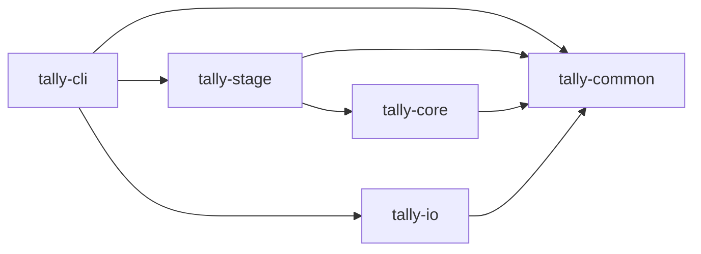

# tally

Totals daily revenue from an orders CSV into a report CSV: `uv run tally <orders.csv> <report.csv>`.

## Layout

A uv workspace with one package per layer under `packages/`. Each package depends only on the packages it points at:



- `tally-common`: the `Order` record, the `OrderSource` port, and `TallyError`, the one exception family.
- `tally-io`: CSV adapters.
- `tally-stage`: loads orders through an `OrderSource`.
- `tally-core`: revenue arithmetic, no I/O.
- `tally-cli`: the entry point; it picks the adapters and catches `TallyError` once.

## Rules

- Test first; every change keeps `uv run pytest` green.
- Open items go in `BACKLOG.md`, numbered.

## Checks

```bash
uv sync
uv run pytest
```
