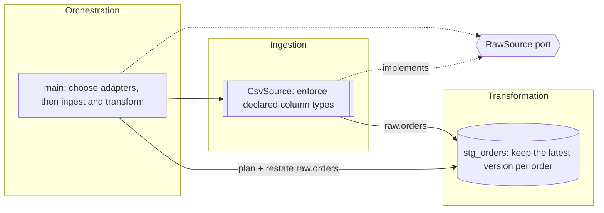

# Design Spec

Two modes share one spec format, one set of rules, and one size gate:

- **Design mode**: a new system or a restructure. Design from the domain outward, produce the spec, STOP for approval, then implement.
- **Document mode**: an existing project. Derive the spec from the code, mark what was inferred, list deviations from the rules as findings, and change no code.

Pick the mode from the request. "Design", "build", "architect", or given inputs and outputs means design mode. "Document", "diagram", "explain the architecture", "resync the design", or "review the design of" an existing codebase means document mode. State the mode and size class in the first line.

## 1. Size gate (both modes)

- **Small**: at most two layers and under ~150 lines, or an existing ADR already forces the answer. Design mode: skip the spec and skip SQLMesh; plain `duckdb` in one typed module is fine. Document mode: a five-line summary plus the component flowchart only.
- **Standard**: three or more layers, or over ~150 lines, in one process. Full spec (section 3). Add a C4 context view only when the process touches two or more external systems (storage, APIs, services).
- **Large**: multiple processes or services. Full spec plus C4 context and container views.

A single process with external storage is Standard, not Large: external systems earn the context view, separate processes earn the container view.

## 2. Model before topology (design mode)

1. Name the domain concepts and the states each moves through.
2. Derive the numbers that can change the design: row volumes, growth rate, refresh frequency, latency budget, memory ceiling. Show the arithmetic. These decide model kinds (FULL vs INCREMENTAL_BY_TIME_RANGE) and whether raw tables are replaced or appended.
3. Challenge contradictory or physically impossible requirements now, not after coding.

## 3. Spec artifacts

Text diagrams only (Mermaid, Markdown tables, directory trees). No rendered SVG unless asked. Write the spec to `docs/design.md`; in design mode, ADRs go to `docs/adr/NNNN-<slug>.md` unless the project already keeps decisions elsewhere.

| # | Artifact | When |
|---|----------|------|
| 1 | Size and numbers | Standard, Large |
| 2 | C4 context (`C4Context`) | Two or more external systems, or Large |
| 3 | C4 container (`C4Container`) | Large only |
| 4 | State diagram (`stateDiagram-v2`) of domain entities | Standard, Large |
| 5 | Component flowchart (`flowchart LR`) | Standard, Large, and Small in document mode |
| 6 | Boundary contract table | Standard, Large |
| 7 | Dependency matrix | More than 4 internal modules or workspace packages; otherwise one line stating import direction |
| 8 | Model lineage DAG (`flowchart TD`) | More than 4 models; otherwise note that the flowchart shows lineage. With SQLMesh, also generate `uv run sqlmesh dag docs/lineage.html` (models only; needs network to view). No SQL models: say "not applicable" and how data flows instead |
| 9 | Directory tree | Standard, Large |
| 10 | Decisions (ADRs) | Standard, Large |
| 11 | NFR table | Standard, Large |
| 12 | Findings (rule deviations) | Document mode only |
| 13 | Class diagram | Only when Python contracts are under review |
| 14 | Error-flow sequence diagram | Only when validation, quarantine, or retries are non-trivial |

In a full spec (Standard, Large), when an artifact is skipped by its condition, keep its heading with one line saying why.

Component flowchart: subgraphs by responsibility (ingestion, pure core, data path, assurance, storage, orchestration as they exist); each node labeled with the decision it owns; arrows labeled with the type or table crossing them; dashed arrows to Protocols.

Boundary contract table columns: `boundary | input | output | invariants | owner`.

Dependency matrix: rows import columns. Mark each cell `Y` (imported and declared), `!` (imported but not declared), or `d` (declared but not imported). For a uv workspace, use packages as the unit; otherwise modules. Follow it with one line on cycles and direction.

End the spec with open questions (at most 3). Design mode then adds "Approve or correct before I implement." and stops.

## 4. Document mode procedure

1. **Read the repository's own rules first**: `CLAUDE.md`, contributing guides, the backlog. They override this skill on commit style, branching, and what may be written where.
2. **Locate the copy of record.** If the user names a local folder, work there; if a remote copy is used for analysis, confirm both are on the same commit (`git log --oneline -1`) and that the local one has no uncommitted changes before trusting the analysis.
3. **Inventory with commands**, not by reading every file:
   - size, counting tracked files only so `.venv` and build output stay out: `git ls-files -z -- '*.py' '*.sql' | xargs -0 cat | wc -l`; outside a git repository, prune those folders instead: `find . \( -name .git -o -name .venv -o -name node_modules -o -name build -o -name dist \) -prune -o -type f \( -name '*.py' -o -name '*.sql' \) -print0 | xargs -0 cat | wc -l`; plus source-only lines per package
   - imports between internal packages (source only, not tests):
     `for d in packages/*/src/*; do me=$(basename $d); echo "$me: $(grep -rhoE '^\s*(from|import) <prefix>_[a-z]+' $d | grep -oE '<prefix>_[a-z]+' | grep -v "^$me$" | sort -u | tr '\n' ' ')"; done`
   - declared runtime dependencies, separately from dev groups:
     `python3 -c "import tomllib; d=tomllib.load(open('<pkg>/pyproject.toml','rb')); print(d['project'].get('dependencies', []))"`
   - models: `grep -rnE 'name |kind |grain |audits|FROM |JOIN ' models`
   - contracts: schemas, Pydantic models, Protocols and ABCs, frozen dataclasses, `Literal` vocabularies for outcomes and verdicts
   - orchestration: the top-level run function's steps, and the CLI's exit codes
4. **Inventory existing documentation and audits.** Specs, decision records, design evaluations, and backlog entries are authorities or prior findings. Map them in the spec; never restate or overrule them. If the code contradicts a spec, report it as a finding.
5. Apply the size gate.
6. **Derive** each artifact. Facts read from code are stated plainly; anything deduced (domain states, the decision a component owns, intent) is marked *inferred*. Unknown volumes, SLAs, or targets become open questions, never invented numbers.
7. **Decisions**: if the project already keeps decision records, map them in a table (record, what it covers). Otherwise record existing decisions as ADRs with `Status: Accepted` and "recorded retroactively from code".
8. **NFRs**: only those the code, CI, or tests actually verify, each citing its check.
9. **Findings**: deviations from the rules (section 5), ranked by impact, each with rule number, file, consequence, and fix direction. Label each **new** or **known**; for known ones, cite the backlog item or audit instead of re-arguing it. Diagrams in docs that disagree with the code (layering, dependency, architecture pictures) are findings under rule 14. Mark allowed exceptions and rules that do not apply (e.g. no SQL models) separately, not as findings.
10. Validate the diagrams (section 7) and run the repository's own checks on what was added.
11. **Commit** only when asked, following the repository's rules (branch from the default branch; the repo's message style; no model identifiers if the repo forbids them). Do not push or open a pull request unless asked.
12. **Resync** ("resync the design"): rerun this procedure and report what changed against the existing `docs/design.md` before overwriting it.

Works for any codebase; adapt the inventory commands to its language and package layout. Without SQLMesh, derive lineage from SQL `FROM`/`JOIN` clauses or data-flow code, and contracts from schemas, Protocols, and dataclasses; say which artifacts have no equivalent.

## 5. Design rules

| # | Rule | Diagram that shows it |
|---|------|-----------------------|
| 1 | Apply the size gate. Standard and Large designs get a spec and wait for approval before code. | The spec itself |
| 2 | Every layer, model, and component owns a decision. One that only forwards or reshapes data without enforcing a rule is deleted. | Component flowchart, nodes labeled by decision |
| 3 | One responsibility per component: ingestion (adapters), transformation (models or pure core), and orchestration (composition root) are separate. The composition root calls; it never transforms, queries, or writes files itself. | Component flowchart subgraphs |
| 4 | Boundaries are typed: raw tables declared with column types; models declare `grain` and cast every output column; Python contracts use Protocols (read-only attributes as `@property`, so frozen dataclasses satisfy them) and frozen slotted dataclasses. Never dicts or bare tuples across a boundary. | Boundary contract table; class diagram if needed |
| 5 | Each boundary's invariants are enforced where the data is produced (SQLMesh audits, model validators). Failures are values or one project exception family, caught once per unit of work. Audits are blocking: a failure raises `PlanError`, skips downstream models, but the failing model's own table keeps the failing rows; consumers read marts only. | Boundary contract table; state diagram failure states |
| 6 | Dependencies point inward and are declared exactly: each package declares what it imports and imports what it declares. Core logic depends on Protocols; concrete adapters are chosen only in the composition root. | Dependency matrix with `Y`/`!`/`d` |
| 7 | Set-based work stays in DuckDB SQL models. A Python model is allowed only when SQL cannot express the step, and the spec names it. | Lineage DAG or flowchart |
| 8 | SQL lives in `models/` and `audits/` files. No SQL assembled in Python beyond identifier-only DDL inside adapters, and every identifier in it is first checked against an allowlist of declared tables (for SQLMesh projects, read from `external_models.yaml`); never interpolate an unchecked name. | Directory tree |
| 9 | Prefer many small models or stages with one purpose each over large multi-purpose ones. | Lineage DAG or flowchart |
| 10 | Design from the domain outward: concepts and states first, then map inputs and outputs onto them. | State diagram |
| 11 | Every model has a SQLMesh unit test covering every output column; every adapter has a test against an in-memory DuckDB. A model change without a matching test change fails the pipeline. | Error-flow sequence diagram with fakes |
| 12 | Every significant decision gets a record stating context, alternatives considered, and consequences. | Decisions table |
| 13 | Quality requirements are testable NFRs with a measurable target and a verification method. | NFR table |
| 14 | Diagrams, tests, and code change together; any diagram in the docs that disagrees with the code is a defect. | All |

## 6. Templates

### ADR

```markdown
### ADR-NNNN: <decision title>
- Status: Proposed | Accepted | Superseded by ADR-NNNN
- Date: YYYY-MM-DD
- Context: <problem and constraints, 2-4 lines>
- Decision: <what we will do>
- Alternatives: <option: why rejected> (at least one)
- Consequences: <what gets easier, what gets harder>
```

### NFR

```markdown
| ID | Requirement | Target | Verified by |
|----|-------------|--------|-------------|
| NFR-01 | Full refresh time | < 5 min on 50M rows | timed pipeline run in CI |
```

### Finding (document mode)

```markdown
1. **Rule N, <short name> (new | known).** <what deviates, with file>. Consequence: <what breaks or misleads>. Fix: <direction>. (Known: cite backlog item or audit.)
```

### Dependency matrix excerpt (document mode)

```markdown
| imports ↓ / of → | common | frame | plan | verify |
|---|---|---|---|---|
| report | | **!** | **d** | **d** |
```

In that real case, `report` imported `frame` without declaring it and declared `plan` and `verify` without importing them; it installed only because `frame` arrived transitively through the unused declarations.

## 7. Mermaid conventions and validation

- Node IDs in PascalCase; labels state the decision the node owns. Quote labels containing punctuation.
- Label arrows with the table or type that crosses them.
- Use `[[ ]]` for adapters and I/O, `{{ }}` for Protocols, `[( )]` for tables and models.
- Dashed arrows point to the Protocols a component implements or depends on.



Validate every spec before delivering it with the bundled checker, which parses each Mermaid block with Mermaid's own parser (syntax only, no rendering):

```bash
node "${CLAUDE_SKILL_DIR}/tools/validate_mermaid.mjs" docs/design.md
```

Exit 0 means every diagram parses; exit 1 lists each failing block with its line number. It needs Node 22.22.2+ or 24.15+. Its first run installs pinned `mermaid` and `jsdom` into a shared cache (`~/.cache/design-spec-mermaid`, or `DESIGN_SPEC_MERMAID_CACHE`), which needs network once; later runs install nothing, and the project gains no npm files. Fix any failing block before showing the spec.

To render the diagrams as well (not needed for validation): `npx -y @mermaid-js/mermaid-cli -i docs/design.md -o <scratch folder>/out.md`, which needs a headless Chrome.

## 8. Default pattern

For a Standard data pipeline, the default pattern comes from the templates indexed in [template-0-summaries](https://github.com/CarlosSolrac/template-0-summaries/tree/main). Pick the template that fits the stack; its `docs/design.md` is the worked example (match its shape and density) and its `docs/adr/` holds the decisions behind the pattern. When the project already has a pattern, follow it and record the difference from the template in an ADR; when no template fits, record why in an ADR.

## 9. Implementation

Python code follows the `python-code-standards` skill. With SQLMesh, also:

- `uv run sqlmesh test` is among the checks that must pass before work is declared done.
- When a pipeline run fails, the Python API raises a generic `PlanError`; rerun with the CLI (`uv run sqlmesh plan --restate-model <raw table> --auto-apply --no-prompts`) to see which audit or test failed.
