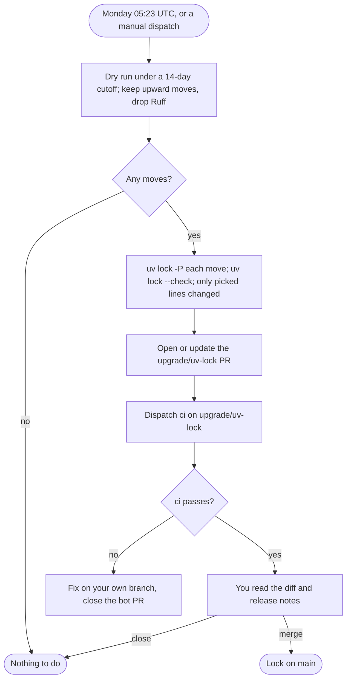

Not for nightshift: its steps change CI and dependencies; work it in a daytime session.

# Plan: a CI pipeline that upgrades packages and runs the tests

A plan, not the pipeline: no workflow, bot configuration or dependency file has been created or changed. It gives the
triggers, the jobs and the exact commands each job runs, how upgrade pull requests are raised and approved and why that
mechanism, and a rollout checklist. The workflows are written out in full so rollout is a copy, not a design session.

- **Snapshot:** 2026-10-16. Every command below was run on `origin/main` (58e395a) that day unless it says otherwise; action
  versions are the newest release at least two weeks old on that day.
- **Companion plan:** which versions to move to, and the manual procedure for every declaration a bot cannot touch, are in
  `docs/plans/package-upgrades.md` (see [PR #12](https://github.com/CarlosSolrac/python-code-standards/pull/12), merged).
  This plan does not repeat it; it automates the part of it that is safe to automate and runs the tests on everything.

## What exists today

- **No CI of its own.** There is no `.github/` at the repository root. The only workflow files in the tree are the templates
  and a copy of them inside an eval fixture (`nightshift/evals/fixtures/base/.github/workflows/`), which never run here.
- **The checks** (`python-code-standards/README.md`, *Verifying the skill itself*), run from `python-code-standards/`: pytest with
  100% statement and branch coverage, `ruff check`, `check_declarations.py`, complexipy, deptry. Plus, from the repository root,
  the Mermaid checker's tests (`docs/plans/design-spec.md`). PR #12 adds `ruff format --check`, Pyright, MyPy and pip-audit to its
  gates. All of them pass on `origin/main`: pytest 631 passed at 100% (15 s including start-up), Pyright and MyPy clean, pip-audit
  "No known vulnerabilities found", `uv lock --check` exit 0, the node tests at 100% line and branch coverage (6 s). pytest also
  passes in a depth-1 clone, so CI needs no `fetch-depth: 0`.
- **The evals are not CI material.** `python-code-standards/evals/RUNBOOK.md` and `nightshift/evals/` (`run-headless.sh` drives
  `claude -p` through up to five runs of a full unattended night) start real Claude Code sessions, with Codex reviews for
  nightshift. Each run costs model usage, takes from minutes to hours, needs your Claude and Codex logins as secrets, and is graded
  against a baseline arm rather than passing or failing. They stay manual, run by their runbooks. The grader itself
  (`evals/grade.py`) is unit-tested and covered by pytest, so CI does exercise that part.
- **Templates for target projects.** `python-code-standards/skill/assets/ci.yml` (`verify`, on push to `main` and every pull
  request) and `mutation.yml` (report-only mutmut, nightly and on demand) are what `setup-standards.sh` writes into a project.
  This repository's CI reuses their shape; how it differs is under [Compared with the templates](#compared-with-the-templates).

## Constraints the pipeline respects

1. **Your approval for every dependency change, CI edit and commit** (your global `CLAUDE.md`). Nothing in the pipeline merges or
   pushes to `main`: upgrades arrive as pull requests, and merging one is the approval. No auto-merge anywhere.
2. **Releases at least two weeks old.** The lock refresh resolves with `--exclude-newer "14 days"`; action pins are chosen by the
   same rule.
3. **Ruff stays below its next minor** (`ruff>=0.16.10,<0.17`, "minor releases change which rules fire"). The refresh only moves
   packages within the constraints as written, and leaves Ruff out entirely, because the template's hook `rev` must equal the
   locked Ruff (PR #12) and that change needs the template procedure below. `conformance.py` stays the drift check when you move
   Ruff by hand.
4. **Templates and their heredocs stay byte-identical.** `tests/test_setup_script.py` fails if an asset differs from its copy in
   `setup-standards.sh`, or if the digest history (`skill/tools/template_history.py`) does not cover it. So no automated pull
   request touches `skill/assets/`, the heredocs, or the eval fixture; those move only by PR #12's manual steps.
5. **Mutation testing needs `os.fork`.** It runs on `ubuntu-latest`, never on a Windows runner.

## Decisions for you

Each is logged with its full pros and cons in the night's log; the recommendation is what the workflows below implement.

1. **How upgrade PRs are raised: a scheduled `uv lock` workflow** (log D15). Compared with Dependabot and Renovate under
   [Alternatives](#alternatives-for-raising-upgrade-prs).
2. **Which token opens them: `GITHUB_TOKEN`** (log D16), which needs one repository setting. A PR it opens does not run CI the
   normal way (see [step 2 below](#how-upgrade-prs-are-raised-and-approved)), so `upgrade.yml` then dispatches `ci` on the PR's
   branch itself. A GitHub App token is the alternative that makes CI run on the PR like on any other.
3. **What CI runs: the README's checks plus format, Pyright, MyPy, pip-audit and `uv sync --locked`** (log D17) — the same gates
   as PR #12. The README's list then needs the four added commands (rollout step 2).
4. **Pin actions by full commit SHA with the version as a comment**, as PR #12's decision 2 recommends for the templates, and
   **pin uv** in `setup-uv` to the version you run locally (0.11.29 today), so the lock CI checks and the lock the refresh writes
   come from the same uv as your own `uv lock`. Raise it by hand, together with your local uv.
5. **Branch protection: do not require the checks yet.** You commit to `main` directly today; required status checks would
   reject those pushes (or need admin bypass). Turn it on later if you move to pull requests for everything.
6. **The upgrade workflow commits on its own branch** (log D18). Each week with moves it commits `uv.lock` to `upgrade/uv-lock`
   before you have seen it, so that CI has tested the change by the time you look. Adding `upgrade.yml` (rollout step 5) is your
   standing approval of those side-branch commits; merging a pull request is your approval of that upgrade, and nothing reaches
   `main` otherwise. If you want no commit you did not make, have the workflow write `uv lock $ARGS` to the job summary instead and
   run it yourself, at the cost of CI no longer testing it first.

## Triggers

| Workflow | Trigger | Why |
|---|---|---|
| `ci.yml` | `push` to `main` | every commit on `main` is checked, including your direct commits |
| `ci.yml` | `pull_request` (any base) | nightshift's draft PRs, the upgrade PRs and your own are checked before merge |
| `ci.yml` | `schedule` Mondays 06:23 UTC | pip-audit sees newly published advisories even in a week with no push |
| `ci.yml` | `workflow_dispatch` | a manual re-run on any branch; also how `upgrade.yml` starts CI on its own branch |
| `upgrade.yml` | `schedule` Mondays 05:23 UTC, `workflow_dispatch` | weekly lock refresh; an hour before the weekly CI run |
| `mutation.yml` | `schedule` Sundays 03:17 UTC, `workflow_dispatch` | report-only and slow; weekly is enough for a repository that changes in bursts (the template's nightly also works) |

No `paths:` filters: the whole `ci.yml` run is about a minute of work, and a filtered-out workflow leaves a required check pending
forever if you later turn on branch protection. Scheduled workflows in a public repository are disabled by GitHub after 60 days
without repository activity; re-enable them from the Actions tab if that happens. The repository is public, so standard
GitHub-hosted runners cost nothing.

## Jobs and the commands they run

### `ci.yml`

Two jobs, in parallel. Each command is its own step, so a failure names the gate.

```yaml
name: ci

on:
  push:
    branches: [main]
  pull_request:
  schedule:
    - cron: "23 6 * * 1" # Mondays: pip-audit sees new advisories even when nothing was pushed
  workflow_dispatch:

permissions:
  contents: read

jobs:
  python:
    runs-on: ubuntu-latest
    defaults:
      run:
        shell: bash
        working-directory: python-code-standards
    steps:
      - uses: actions/checkout@3d3c42e5aac5ba805825da76410c181273ba90b1 # v7.0.1
      - uses: astral-sh/setup-uv@c18668ad3cf93ea998bef934396af7bb5c839dc7 # v10.2.0
        with:
          version: "0.11.29"
          enable-cache: true
      # This repository commits uv.lock, so CI installs from it exactly; a stale lock fails here.
      - name: Sync the environment from the lock
        run: uv sync --locked --all-groups
      - name: Tests, 100% statement and branch coverage
        run: uv run pytest --cov=skill.tools --cov=evals.grade --cov-branch
      # evals/fixtures/ is deliberately non-conforming, so every tool gets the README's paths, never the whole tree.
      - name: Ruff lint (conformance.py is the drift check for Ruff upgrades)
        run: uv run ruff check skill/tools skill/assets/conformance.py tests evals/grade.py
      - name: Ruff format
        run: uv run ruff format --check skill/tools skill/assets/conformance.py tests evals/grade.py
      - name: Every variable declared before first binding
        run: uv run python skill/tools/check_declarations.py skill/tools skill/assets/conformance.py tests evals/grade.py
      - name: Pyright (strict)
        run: uv run pyright skill/tools skill/assets/conformance.py tests evals/grade.py
      - name: MyPy (strict)
        run: uv run mypy skill/tools skill/assets/conformance.py tests evals/grade.py
      - name: Cognitive complexity
        run: uv run complexipy skill/tools tests evals/grade.py
      - name: Imports match declared dependencies
        run: uv run deptry .
      - name: Dependencies with known vulnerabilities
        run: uv run pip-audit

  mermaid:
    runs-on: ubuntu-latest
    defaults:
      run:
        shell: bash
    steps:
      - uses: actions/checkout@3d3c42e5aac5ba805825da76410c181273ba90b1 # v7.0.1
      - uses: actions/setup-node@820762786026740c76f36085b0efc47a31fe5020 # v7.0.0
        with:
          node-version: "24.21.0" # newest 24.x at least two weeks old; the checker needs 22.22.2+ or 24.15+
      # The tests install the pinned mermaid and jsdom into ~/.cache/design-spec-mermaid with npm on first run.
      - name: Mermaid checker tests, 100% line and branch coverage
        run: node --test --experimental-test-coverage --test-coverage-include="design-spec/skill/tools/*.mjs" --test-coverage-lines=100 --test-coverage-branches=100 "design-spec/tests/*.test.mjs"
      - name: Every Mermaid diagram in the repository parses
        run: git ls-files -z '*.md' | xargs -0 node design-spec/skill/tools/validate_mermaid.mjs
```

Notes:

- `shell: bash` is set explicitly because GitHub then runs `bash -eo pipefail`; the default for an unnamed shell has no
  `pipefail`, so a failure on the left of a pipe would pass silently.
- The last step is new; it ran clean on all 25 tracked Markdown files on 2026-10-16 (diagrams in `docs/plans/design-spec.md` and
  `handoff/design-spec/SKILL.draft.md`, none elsewhere). It keeps the plan files' diagrams honest, including this file's.
- Pyright prints "there is a new pyright version available" while the lock holds an older one. Ignore it; the lock decides.
- Node is pinned exactly, by the same two-week rule: 24.21.0 was published 2026-09-07; 24.22.0 (2026-10-14) becomes eligible on
  2026-10-28 (dates from `https://nodejs.org/dist/index.json`). Node is declared nowhere else in this repository (PR #12 leaves it
  out of scope), so this line is its only pin; raise it by hand like the action pins.
- Not worth an `actions/cache` step for the npm cache: the install is two packages and the job stays short without it.

### `upgrade.yml`

One job: pick the upward moves to releases at least two weeks old, lock exactly those, check that nothing else moved, and open or
update one pull request.

```yaml
name: upgrade

on:
  schedule:
    - cron: "23 5 * * 1" # Mondays, an hour before ci's weekly run
  workflow_dispatch:

permissions:
  actions: write # to dispatch ci on the upgrade branch
  contents: write
  pull-requests: write

jobs:
  refresh-lock:
    runs-on: ubuntu-latest
    defaults:
      run:
        shell: bash
        working-directory: python-code-standards
    steps:
      - uses: actions/checkout@3d3c42e5aac5ba805825da76410c181273ba90b1 # v7.0.1
      - uses: astral-sh/setup-uv@c18668ad3cf93ea998bef934396af7bb5c839dc7 # v10.2.0
        with:
          version: "0.11.29"
      - name: Pick upward moves to releases at least 14 days old
        id: pick
        run: |
          uv lock --upgrade --dry-run --exclude-newer "14 days" 2>&1 | tee dry-run.txt
          moves="$(sed -nE 's/^Update ([^ ]+) v([^ ]+) -> v([^ ]+)$/\1 \2 \3/p' dry-run.txt)"
          # A line the pattern missed means uv changed its output format: stop rather than skip it.
          test "$(grep -c '^Update ' dry-run.txt || true)" -eq "$(printf '%s' "$moves" | grep -c . || true)"
          args=""
          while read -r name old new; do
            # Ruff moves only with the template's hook rev (package-upgrades.md, step 4); a move down is a
            # locked release younger than the cutoff, which stays.
            if [ -n "$name" ] && [ "$name" != ruff ] && [ "$(printf '%s\n' "$old" "$new" | sort -V | tail -1)" = "$new" ]; then
              args="$args -P $name==$new"
            fi
          done <<< "$moves"
          echo "args=$args" >> "$GITHUB_OUTPUT"
          rm dry-run.txt
      - name: Lock exactly those versions
        if: steps.pick.outputs.args != ''
        env:
          ARGS: ${{ steps.pick.outputs.args }}
        run: |
          uv lock $ARGS
          uv lock --check
          # Only the picked packages moved: an old and a new version line each, as many lines as words in ARGS.
          test "$(git diff -U0 uv.lock | grep -cE '^[-+]version = ')" -eq "$(wc -w <<< "$ARGS")"
      - name: Open or update the pull request
        id: pr
        if: steps.pick.outputs.args != ''
        uses: peter-evans/create-pull-request@5f6978faf089d4d20b00c7766989d076bb2fc7f1 # v8.1.1
        with:
          branch: upgrade/uv-lock
          add-paths: python-code-standards/uv.lock
          commit-message: Refresh uv.lock to releases at least 14 days old
          title: Refresh uv.lock to releases at least 14 days old
          labels: dependencies
          body: |
            Weekly lock refresh. Only `python-code-standards/uv.lock` changes; every constraint stays as written.

            Moves (`uv lock` arguments): `${{ steps.pick.outputs.args }}`

            Picked from `uv lock --upgrade --dry-run --exclude-newer "14 days"`: upward moves only, Ruff left out.
            To approve: wait for the `ci` run this workflow dispatched on `upgrade/uv-lock` to pass, read the release
            notes of any direct dev tool above, then merge. To reject: close this PR. Keep fixes off this branch, which
            the workflow owns; make them on a branch of your own. Constraint, template, hook, Actions and Mermaid pins
            are not covered: see docs/plans/package-upgrades.md.
      # A pull_request run for a PR opened with GITHUB_TOKEN is withheld (see "How upgrade PRs are raised and
      # approved"); workflow_dispatch is the documented exception that always creates a run.
      - name: Run ci on the upgrade branch
        if: steps.pr.outputs.pull-request-operation == 'created' || steps.pr.outputs.pull-request-operation == 'updated'
        env:
          GH_TOKEN: ${{ github.token }}
          GH_REPO: ${{ github.repository }}
        run: gh workflow run ci.yml --ref upgrade/uv-lock
```

Why each piece:

- **Upward moves only.** A plain `uv lock --upgrade --exclude-newer "14 days"` also *downgrades* every locked package younger than
  the cutoff, and writes `exclude-newer-span = "P14D"` into `uv.lock`'s `[options]`, after which `uv lock --check` (and so CI's
  `uv sync --locked`) fails until `uv lock` is run again. Both reproduced on a scratch copy on 2026-10-16: the plain form moved
  ast-serialize 0.12.1 → 0.11.2, markupsafe 3.0.4 → 3.0.3 and virtualenv 21.14.5 → 21.14.3 down. The dry run plus `-P` writes no
  option and moves nothing down.
- **Same result as PR #12's step 1.** Run on a scratch copy of today's lock, the two steps picked `-P coverage==7.16.2
  -P filelock==4.0.9 -P identify==2.6.20 -P nodeenv==1.11.0 -P platformdirs==4.12.2 -P pyright==1.1.414
  -P python-discovery==1.6.1`, changed 14 version lines and left `uv lock --check` passing — exactly PR #12's targets. A uv stand-in
  printing edge cases confirmed the rest: a Ruff move and a move down are skipped, `1.0 → 1.0.post1` is kept, a line in an unknown
  format fails the step, and no moves leaves `args` empty so nothing after it runs.
- **`sort -V`, not a PEP 440 parser,** so the step needs nothing installed. It orders releases and post-releases correctly; it
  would misorder a pre-release against its final release, which uv does not offer unless a pre-release is already locked.
- **The line-count check** stops the job if locking a picked version pulled in a package that was not picked — possibly a release
  younger than two weeks. Handle that one by hand.
- **`"14 days"`** is uv's relative form (accepted by uv 0.11.29, verified): now minus 14 × 24 hours, so the cutoff is a moment, not
  the end of a day as in PR #12.
- **`ARGS` goes through `env:`,** not `${{ }}` inside the script, so text from a package index never becomes shell code.
- **What it leaves alone:** `nightshift/evals/fixtures/base/uv.lock` (PR #12's decision 3: leave the fixture's lock as is),
  everything in `skill/assets/`, the heredocs, and `validate_mermaid.mjs`'s `PINS`.

### `mutation.yml`

The template's job, pointed at this repository's subdirectory.

```yaml
name: mutation

# Report-only: surviving mutants are listed in the log and uploaded; they never fail the run.
on:
  schedule:
    - cron: "17 3 * * 0" # Sundays
  workflow_dispatch:

permissions:
  contents: read

jobs:
  mutation:
    runs-on: ubuntu-latest
    steps:
      - uses: actions/checkout@3d3c42e5aac5ba805825da76410c181273ba90b1 # v7.0.1
      - uses: astral-sh/setup-uv@c18668ad3cf93ea998bef934396af7bb5c839dc7 # v10.2.0
        with:
          version: "0.11.29"
          enable-cache: true
      - name: Mutation testing
        run: bash python-code-standards/skill/tools/mutation.sh
      - name: Upload survivors
        if: always()
        uses: actions/upload-artifact@043fb46d1a93c77aae656e7c1c64a875d1fc6a0a # v7.0.1
        with:
          name: mutation-report
          path: |
            python-code-standards/mutants/mutmut-cicd-stats.json
            python-code-standards/mutants/survivors.txt
          if-no-files-found: warn
```

`mutation.sh` walks up from its own folder to the nearest `pyproject.toml`, so run from the repository root it works in
`python-code-standards/` and writes `python-code-standards/mutants/`. Its run time on a runner is unmeasured; the first dispatch
measures it (rollout step 6). mutmut is declared for non-Windows platforms only, which the Linux runner satisfies.

## How upgrade PRs are raised and approved



1. **Raised.** `upgrade.yml` runs weekly. When there are moves it opens one pull request from `upgrade/uv-lock`, or updates the
   open one; the body lists the exact `-P` arguments.
2. **Tested.** A pull request opened with `GITHUB_TOKEN` does not get an ordinary `pull_request` run. GitHub's `GITHUB_TOKEN`
   documentation (read 2026-10-16) says the run is created in an approval-required state, started by *Approve workflows to run* in
   the merge box; `peter-evans/create-pull-request`'s documentation says such pull requests "cannot trigger other workflows" at all.
   Either way, `upgrade.yml` does not rely on it: its last step runs `gh workflow run ci.yml --ref upgrade/uv-lock`, and
   `workflow_dispatch` is the documented exception that always creates a run. That run tests the PR's head commit; find it under
   *Actions → ci*, filtered by the branch, and check that it also shows in the PR's checks (rollout step 5). If an
   approval-required `pull_request` run appears as well, approving it is optional.
3. **Approved.** You merge it. That merge is the approval your `CLAUDE.md` asks for; nothing merges automatically.
4. **Rejected or broken.** Close it. If `ci` fails because a tool got stricter (a Pyright release adding diagnostics under
   `strict`, say), fix the code on a branch of your own: the workflow owns `upgrade/uv-lock` and updates it on its next run.
5. **Everything else** — a constraint change (a new major, Ruff's next minor), the template's Actions and hook revs, the Mermaid
   checker's `PINS` — stays the manual procedure in `docs/plans/package-upgrades.md` (see PR #12), through an ordinary pull request
   that `ci` then checks. Its *Re-reading the dates* commands list what has become eligible.

## Alternatives for raising upgrade PRs

| | Scheduled `uv lock` workflow (recommended) | Dependabot | Renovate |
|---|---|---|---|
| Two-week rule | `--exclude-newer "14 days"`, transitive packages included | `cooldown: default-days: 14` (version updates only, not security updates) | `minimumReleaseAge: "14 days"` per update; its docs do not apply it to `lockFileMaintenance`, which deletes and regenerates the lock |
| Ruff held below its next minor | automatic: constraints are never rewritten; Ruff also excluded by name | needs an `ignore` rule for `ruff` minor and major updates | needs a `packageRules` entry |
| Constraints in `pyproject.toml` | never touched, so they stay in step with `pyproject-baseline.toml` | its uv ecosystem raises lower bounds to the new version (reported in dependabot-core #12162), splitting the repository from the template it is kept in step with | `rangeStrategy: update-lockfile` keeps in-range updates lock-only |
| Transitive packages | yes, under the same cutoff | with `allow: dependency-type: all` (uv is one of the ecosystems that supports it) | only through `lockFileMaintenance`, without the age rule |
| Templates, heredocs, digest history | never touched | invisible to it (it scans `.github/workflows` and manifest names it knows) | reachable through `managerFilePatterns` and regex managers, but every such PR would fail the heredoc drift test: the step that fixes it, `postUpgradeTasks`, is blocked by default on the hosted app |
| Mermaid `PINS` in a `.mjs` file | not covered (manual) | not covered | coverable with a regex custom manager |
| CI on its PRs | dispatched by the workflow (D16), or normal with a GitHub App token | runs normally | runs normally with the Mend app |
| What you install or own | ~45 lines of workflow; one repository setting | one `.github/dependabot.yml`; nothing to install | a third-party GitHub App with write access, or a self-hosted Renovate job plus a token; the largest configuration |
| Main risk | uv changes its dry-run output (the step then fails loudly) | constraint drift between repository and template; one PR per package by default | broken template PRs; app permissions |

**Why the scheduled workflow.** It is the only option whose pull requests can never fail the template drift tests or move the Ruff
pin, it applies the age rule to transitive packages too, and its commands are the ones PR #12 already verified by hand. What it
gives up — automatic PRs for templates, hook revs, Actions and `PINS` — no option delivers safely: each of those changes needs the
heredoc copy and `template_history` run, or an exact-pin decision, that only the manual procedure covers.

If you prefer Dependabot anyway, this is the starting configuration that respects the constraints as far as it can (the
constraint-raising behaviour above remains):

```yaml
version: 2
updates:
  - package-ecosystem: uv
    directory: /python-code-standards
    schedule:
      interval: weekly
    cooldown:
      default-days: 14
    ignore:
      - dependency-name: ruff
        update-types: ["version-update:semver-minor", "version-update:semver-major"]
  - package-ecosystem: github-actions
    directory: /
    schedule:
      interval: weekly
    cooldown:
      default-days: 14
```

Independently of the mechanism, GitHub's Dependabot *alerts* (a repository setting, no pull requests) are a cheap second opinion
next to `pip-audit`.

## Compared with the templates

| Template (`skill/assets/ci.yml`, `mutation.yml`) | This repository | Why |
|---|---|---|
| `actions/checkout@v4`, `setup-uv@v5`, `upload-artifact@v4`, floating tags | SHA pins of v7.0.1, v10.2.0, v7.0.1, plus `setup-node` v7.0.0 | decision 4; `setup-uv` publishes no major tags since v8 (PR #12) |
| uv: newest on every run | `version: "0.11.29"` | decision 4 |
| `fetch-depth: 0` for diff-cover | default depth 1 | no diff-cover here; pytest passes in a depth-1 clone |
| runs at the repository root | `working-directory: python-code-standards` | the Python project is a subdirectory |
| `uv run pre-commit run --all-files` | each tool on the README's paths | this repository has no `.pre-commit-config.yaml`, and `evals/fixtures/` is deliberately non-conforming |
| `pytest --cov` + `check_coverage_records` + `diff-cover --fail-under=100` on changed lines | `pytest --cov=skill.tools --cov=evals.grade --cov-branch` with `fail_under = 100` for the whole project | the template protects legacy code from a project-wide floor; here the whole project is already at 100% |
| `check_suppressions --base` | not run | no `suppressions.toml` at this project's root, and the README does not list it; adding one is a standards decision |
| `pip-audit` | same | — |
| no Node | `mermaid` job | the design-spec checker is JavaScript |
| mutation nightly | weekly, from the subdirectory | report-only; this repository changes in bursts |
| no upgrade workflow | `upgrade.yml` | target projects get none; a candidate for the templates once it has run here for a while |

## Rollout checklist

Do these in the daytime, in order; each step has its check. CI files are yours to approve, so this is a list for you (or for a
Claude session you approve step by step), not for nightshift.

1. **Decide** the six decisions above; adjust the YAML if you overrule any. *Check:* the log entries D15–D18 are settled.
2. **`ci.yml`:** on a branch, add `.github/workflows/ci.yml` from this plan, and add the four extra commands (format, Pyright,
   MyPy, pip-audit) to *Verifying the skill itself* in `python-code-standards/README.md`, bash and `cmd` blocks. Push and open a
   pull request. *Check:* both jobs pass on the pull request; open the `python` job and see 631 tests at 100%; then break one
   line in a scratch commit and see the right step fail.
3. **Merge it.** *Check:* the `push` run on `main` passes.
4. **Allow workflows to open pull requests:** *Settings → Actions → General → Workflow permissions →* tick *Allow GitHub Actions
   to create and approve pull requests*; leave the default token permission read-only (`upgrade.yml` asks for write itself).
   *Check:* the box is ticked. (Skip if you chose the App token: create the app, install it on this repository, store its id and
   key as secrets, add an `actions/create-github-app-token` step, pass its token to the PR step, and drop the dispatch step and
   `actions: write`, since CI then runs on the pull request by itself.)
5. **`upgrade.yml`:** add it the same way and merge — this is the approval of its weekly commits to `upgrade/uv-lock`
   (decision 6) — then run `gh workflow run upgrade.yml`. *Check:* a pull request
   `Refresh uv.lock to releases at least 14 days old` appears with only `python-code-standards/uv.lock` changed; on 2026-10-16
   it would have listed PR #12's seven moves (if you have already done PR #12's step 1 by hand, expect no pull request and an empty
   `args` in the log). *Check:* a `ci` run on `upgrade/uv-lock` (event `workflow_dispatch`) starts and passes, and its checks show
   on the pull request; if they do not, read the result from the run itself, or switch to the App token. Merge or close it.
6. **`mutation.yml`:** add it, merge, then `gh workflow run mutation.yml`. *Check:* the run finishes and the `mutation-report`
   artifact holds both files; note the duration and add `timeout-minutes:` of about twice that.
7. **Optional:** turn on Dependabot alerts; require the `python` and `mermaid` checks on `main` once you work only through pull
   requests (decision 5).
8. **After four Mondays:** check that each refresh PR was raised, tested and merged or closed without surprises; if the manual list
   in PR #12 keeps growing, revisit Renovate for the parts it can reach.

To undo any of it: delete the workflow file and untick the setting from step 4. Nothing else in the repository depends on them.

## Not in this plan

- Running the evals in CI (see *What exists today*).
- A Windows leg. Your machine is Windows and the README's `cmd` blocks are unexecuted transcriptions; a `windows-latest` job running
  pytest would test them, but it is not part of the checks you listed.
- Automating PR #12's template, hook, Actions and `PINS` steps. It would need a tool that copies an asset into its heredoc and runs
  `template_history`, which does not exist yet.
