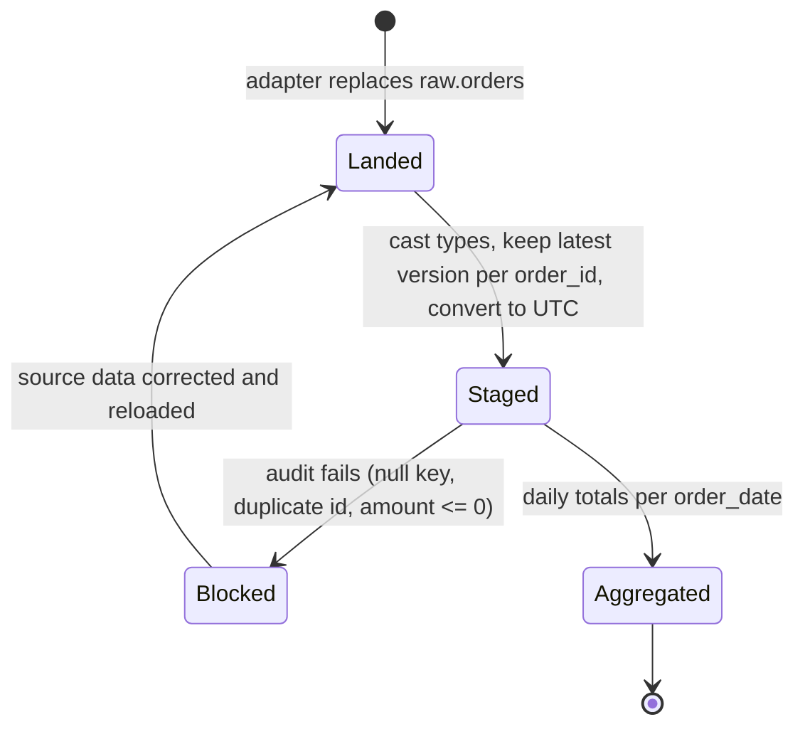
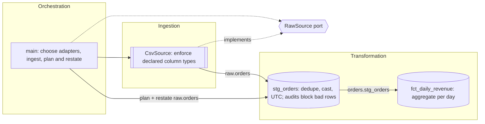

# Design Spec

Two modes share one spec format, one set of rules, and one size gate:

- **Design mode**: a new system or a restructure. Design from the domain outward, produce the spec, STOP for approval, then implement.
- **Document mode**: an existing project. Derive the spec from the code, mark what was inferred, list deviations from the rules as findings, and change no code.

Pick the mode from the request. "Design", "build", "architect", or given inputs and outputs means design mode. "Document", "diagram", "explain the architecture", "resync the design", or "review the design of" an existing codebase means document mode. State the mode and size class in the first line.

## 1. Size gate (both modes)

- **Small**: at most two layers and under ~150 lines, or an existing ADR already forces the answer. Design mode: skip the spec and skip SQLMesh; plain `duckdb` in one typed module is fine. Document mode: a five-line summary plus the component flowchart only.
- **Standard**: three or more layers, or over ~150 lines, in one process. Full spec (section 3). Add a C4 context view only when the process touches two or more external systems (storage, APIs, services).
- **Large**: multiple processes or services. Full spec plus C4 context and container views.

A single process with external storage is Standard, not Large: external systems earn the context view, separate processes earn the container view.

## 2. Model before topology (design mode)

1. Name the domain concepts and the states each moves through.
2. Derive the numbers that can change the design: row volumes, growth rate, refresh frequency, latency budget, memory ceiling. Show the arithmetic. These decide model kinds (FULL vs INCREMENTAL_BY_TIME_RANGE) and whether raw tables are replaced or appended.
3. Challenge contradictory or physically impossible requirements now, not after coding.

## 3. Spec artifacts

Text diagrams only (Mermaid, Markdown tables, directory trees). No rendered SVG unless asked. Write the spec to `docs/design.md`; in design mode, ADRs go to `docs/adr/NNNN-<slug>.md` unless the project already keeps decisions elsewhere.

| # | Artifact | When |
|---|----------|------|
| 1 | Size and numbers | Standard, Large |
| 2 | C4 context (`C4Context`) | Two or more external systems, or Large |
| 3 | C4 container (`C4Container`) | Large only |
| 4 | State diagram (`stateDiagram-v2`) of domain entities | Standard, Large |
| 5 | Component flowchart (`flowchart LR`) | Always (Small in document mode too) |
| 6 | Boundary contract table | Standard, Large |
| 7 | Dependency matrix | More than 4 internal modules or workspace packages; otherwise one line stating import direction |
| 8 | Model lineage DAG (`flowchart TD`) | More than 4 models; otherwise note that the flowchart shows lineage. With SQLMesh, also generate `uv run sqlmesh dag docs/lineage.html` (models only; needs network to view). No SQL models: say "not applicable" and how data flows instead |
| 9 | Directory tree | Standard, Large |
| 10 | Decisions (ADRs) | Standard, Large |
| 11 | NFR table | Standard, Large |
| 12 | Findings (rule deviations) | Document mode only |
| 13 | Class diagram | Only when Python contracts are under review |
| 14 | Error-flow sequence diagram | Only when validation, quarantine, or retries are non-trivial |

When an artifact is skipped by its condition, keep its heading with one line saying why.

Component flowchart: subgraphs by responsibility (ingestion, pure core, data path, assurance, storage, orchestration as they exist); each node labeled with the decision it owns; arrows labeled with the type or table crossing them; dashed arrows to Protocols.

Boundary contract table columns: `boundary | input | output | invariants | owner`.

Dependency matrix: rows import columns. Mark each cell `Y` (imported and declared), `!` (imported but not declared), or `d` (declared but not imported). For a uv workspace, use packages as the unit; otherwise modules. Follow it with one line on cycles and direction.

End the spec with open questions (at most 3). Design mode then adds "Approve or correct before I implement." and stops.

## 4. Document mode procedure

1. **Read the repository's own rules first**: `CLAUDE.md`, contributing guides, the backlog. They override this skill on commit style, branching, and what may be written where.
2. **Locate the copy of record.** If the user names a local folder, work there; if a remote copy is used for analysis, confirm both are on the same commit (`git log --oneline -1`) and that the local one has no uncommitted changes before trusting the analysis.
3. **Inventory with commands**, not by reading every file:
   - size: `find . -path ./.git -prune -o -type f \( -name '*.py' -o -name '*.sql' \) -print | xargs wc -l | tail -1`, plus source-only lines per package
   - imports between internal packages (source only, not tests):
     `for d in packages/*/src/*; do me=$(basename $d); echo "$me: $(grep -rhoE '^\s*(from|import) <prefix>_[a-z]+' $d | grep -oE '<prefix>_[a-z]+' | grep -v "^$me$" | sort -u | tr '\n' ' ')"; done`
   - declared runtime dependencies, separately from dev groups:
     `python3 -c "import tomllib; d=tomllib.load(open('<pkg>/pyproject.toml','rb')); print(d['project'].get('dependencies', []))"`
   - models: `grep -rnE 'name |kind |grain |audits|FROM |JOIN ' models`
   - contracts: schemas, Pydantic models, Protocols and ABCs, frozen dataclasses, `Literal` vocabularies for outcomes and verdicts
   - orchestration: the top-level run function's steps, and the CLI's exit codes
4. **Inventory existing documentation and audits.** Specs, decision records, design evaluations, and backlog entries are authorities or prior findings. Map them in the spec; never restate or overrule them. If the code contradicts a spec, report it as a finding.
5. Apply the size gate.
6. **Derive** each artifact. Facts read from code are stated plainly; anything deduced (domain states, the decision a component owns, intent) is marked *inferred*. Unknown volumes, SLAs, or targets become open questions, never invented numbers.
7. **Decisions**: if the project already keeps decision records, map them in a table (record, what it covers). Otherwise record existing decisions as ADRs with `Status: Accepted` and "recorded retroactively from code".
8. **NFRs**: only those the code, CI, or tests actually verify, each citing its check.
9. **Findings**: deviations from the rules (section 5), ranked by impact, each with rule number, file, consequence, and fix direction. Label each **new** or **known**; for known ones, cite the backlog item or audit instead of re-arguing it. Diagrams in docs that disagree with the code (layering, dependency, architecture pictures) are findings under rule 14. Mark allowed exceptions and rules that do not apply (e.g. no SQL models) separately, not as findings.
10. Validate the diagrams (section 7) and run the repository's own checks on what was added.
11. **Commit** only when asked, following the repository's rules (branch from the default branch; the repo's message style; no model identifiers if the repo forbids them). Do not push or open a pull request unless asked.
12. **Resync** ("resync the design"): rerun this procedure and report what changed against the existing `docs/design.md` before overwriting it.

Works for any codebase. Without SQLMesh, derive lineage from SQL `FROM`/`JOIN` clauses or data-flow code, and contracts from schemas, Protocols, and dataclasses; say which artifacts have no equivalent.

## 5. Design rules

| # | Rule | Diagram that shows it |
|---|------|-----------------------|
| 1 | Apply the size gate. Standard and Large designs get a spec and wait for approval before code. | The spec itself |
| 2 | Every layer, model, and component owns a decision. One that only forwards or reshapes data without enforcing a rule is deleted. | Component flowchart, nodes labeled by decision |
| 3 | One responsibility per component: ingestion (adapters), transformation (models or pure core), and orchestration (composition root) are separate. The composition root calls; it never transforms, queries, or writes files itself. | Component flowchart subgraphs |
| 4 | Boundaries are typed: raw tables declared with column types; models declare `grain` and cast every output column; Python contracts use Protocols (read-only attributes as `@property`, so frozen dataclasses satisfy them) and frozen slotted dataclasses. Never dicts or bare tuples across a boundary. | Boundary contract table; class diagram if needed |
| 5 | Each boundary's invariants are enforced where the data is produced (SQLMesh audits, model validators). Failures are values or one project exception family, caught once per unit of work. Audits are blocking: a failure raises `PlanError`, skips downstream models, but the failing model's own table keeps the failing rows; consumers read marts only. | Boundary contract table; state diagram failure states |
| 6 | Dependencies point inward and are declared exactly: each package declares what it imports and imports what it declares. Core logic depends on Protocols; concrete adapters are chosen only in the composition root. | Dependency matrix with `Y`/`!`/`d` |
| 7 | Set-based work stays in DuckDB SQL models. A Python model is allowed only when SQL cannot express the step, and the spec names it. | Lineage DAG or flowchart |
| 8 | SQL lives in `models/` and `audits/` files. No SQL assembled in Python beyond identifier-only DDL inside adapters, with identifiers from typed config, never from input data. | Directory tree |
| 9 | Prefer many small models or stages with one purpose each over large multi-purpose ones. | Lineage DAG or flowchart |
| 10 | Design from the domain outward: concepts and states first, then map inputs and outputs onto them. | State diagram |
| 11 | Every model has a SQLMesh unit test covering every output column; every adapter has a test against an in-memory DuckDB. A model change without a matching test change fails the pipeline. | Error-flow sequence diagram with fakes |
| 12 | Every significant decision gets a record stating context, alternatives considered, and consequences. | Decisions table |
| 13 | Quality requirements are testable NFRs with a measurable target and a verification method. | NFR table |
| 14 | Diagrams, tests, and code change together; any diagram in the docs that disagrees with the code is a defect. | All |

## 6. Templates

### ADR

```markdown
### ADR-NNNN: <decision title>
- Status: Proposed | Accepted | Superseded by ADR-NNNN
- Date: YYYY-MM-DD
- Context: <problem and constraints, 2-4 lines>
- Decision: <what we will do>
- Alternatives: <option: why rejected> (at least one)
- Consequences: <what gets easier, what gets harder>
```

### NFR

```markdown
| ID | Requirement | Target | Verified by |
|----|-------------|--------|-------------|
| NFR-01 | Full refresh time | < 5 min on 50M rows | timed pipeline run in CI |
```

### Finding (document mode)

```markdown
1. **Rule N, <short name> (new | known).** <what deviates, with file>. Consequence: <what breaks or misleads>. Fix: <direction>. (Known: cite backlog item or audit.)
```

### Dependency matrix excerpt (document mode)

```markdown
| imports ↓ / of → | common | frame | plan | verify |
|---|---|---|---|---|
| report | | **!** | **d** | **d** |
```

In that real case, `report` imported `frame` without declaring it and declared `plan` and `verify` without importing them; it installed only because `frame` arrived transitively through the unused declarations.

## 7. Mermaid conventions and validation

- Node IDs in PascalCase; labels state the decision the node owns. Quote labels containing punctuation.
- Label arrows with the table or type that crosses them.
- Use `[[ ]]` for adapters and I/O, `{{ }}` for Protocols, `[( )]` for tables and models.
- Validate every spec before delivering it. Preferred: `npx -y @mermaid-js/mermaid-cli -i docs/design.md -o /tmp/out.md` (needs a headless Chrome). If Chrome is unavailable, check syntax with Mermaid's own parser: install `mermaid@11` and `jsdom` with npm in a scratch folder and run `node validate.mjs docs/design.md` with this script (it handles flowchart, state, and C4 diagrams):

```javascript
// Parse every mermaid block in a Markdown file with Mermaid's own parser (syntax check, no rendering).
import { readFileSync } from "node:fs";
import { JSDOM } from "jsdom";
const dom = new JSDOM("<!doctype html><html><body></body></html>");
globalThis.window = dom.window; globalThis.document = dom.window.document;
globalThis.DOMParser = dom.window.DOMParser; globalThis.navigator ??= dom.window.navigator;
const { default: mermaid } = await import("mermaid");
mermaid.initialize({ startOnLoad: false });
const text = readFileSync(process.argv[2], "utf8");
const blocks = [...text.matchAll(/```mermaid\n([\s\S]*?)```/g)].map((m) => m[1]);
let failed = 0;
for (const [i, src] of blocks.entries()) {
  try { const r = await mermaid.parse(src); console.log(`block ${i + 1}: OK (${r.diagramType})`); }
  catch (e) { failed++; console.log(`block ${i + 1}: FAIL ${String(e.message ?? e).split("\n").slice(0, 4).join(" | ")}`); }
}
process.exit(failed ? 1 : 0);
```

Fix any failing block before showing the spec.

## 8. Worked example (document mode, Standard)

The reference skeleton (section 10) documented by its own procedure. Match this shape and density. For a larger real example, see `docs/design.md` in the ParquetToXL repository (Standard with C4 context, 11 workspace packages, dependency matrix with `!`/`d` markers, findings labeled new and known).

````markdown
# Design: Orders pipeline

Mode: **Document** (generated from existing code on 2026-10-12). Items marked *inferred* were deduced from code; confirm or correct them.

## 1. Size and numbers
- Classification: **Standard**: 3 layers, 201 lines across Python, SQL, and YAML; one external system (local files), so no C4 view.
- Volume: sample data only (4 raw rows). Production volume and refresh frequency unknown (open question 1).

## 2. Domain states
*Inferred* from the models and audits.


## 3. Components


## 4. Boundary contracts
| Boundary | Input | Output | Invariants | Owner |
|---|---|---|---|---|
| Ingestion | `data/orders.csv` | `raw.orders` | Column types per `external_models.yaml`; replaced, never appended | `CsvSource` |
| Staging | `raw.orders` | `orders.stg_orders` | Grain `order_id`; not_null, unique_values(order_id), assert_positive_amount | `stg_orders` |
| Mart | `orders.stg_orders` | `orders.fct_daily_revenue` | Grain `order_date`; not_null, unique_values(order_date) | `fct_daily_revenue` |

## 5. Dependency matrix
Skipped: 3 Python modules (threshold: more than 4). Import direction is `main → adapters, ports`.

## 6. Model lineage
Skipped: 2 models (threshold: more than 4). The component flowchart shows lineage.

## 8. Decisions
- ADR-0001: Use SQLMesh for transformations, with an exit path.
- ADR-0002: Replace raw tables and restate downstream on every run.

## 9. NFRs
| ID | Requirement | Target | Verified by |
|---|---|---|---|
| NFR-01 | Bad data never reaches marts | Audit failure exits non-zero, marts unchanged | Bad-row scenario run |
| NFR-02 | Same-day reruns process new data | New raw rows appear in marts | New-row scenario run |

## 10. Findings
1. **Rule 5, failing rows stay in staging (new).** After an audit failure, `orders.stg_orders` keeps the failing rows. Consequence: a staging reader sees bad data. Fix: consumers read marts only (NFR-01).
2. **Rule 8 (allowed exception).** `CsvSource` builds identifier-only DDL with f-strings from typed config.

## Open questions
1. What are production row volumes and refresh frequency?
````

## 9. Implementation conventions

- Python 3.13+, managed with uv (`uv init --package`, `uv add`, `uv run ...`). Never pip.
- PEP 8 with a 220-character line length; ruff and mypy configured in `pyproject.toml` (section 10).
- Strict typing: every class, function, method, and module documented with docstrings; every variable explicitly annotated before first binding, including loop targets (bare PEP 526 annotation before the `for`). Avoid comprehensions where their targets would be unannotated; use an annotated loop instead.
- SQLMesh and DuckDB ship inline types (`py.typed`). For any other dependency without them, install stubs (`uv add --dev types-<pkg>`); if none exist, generate them with `uv run stubgen -p <pkg> -o typings` and set `mypy_path = "typings"`.
- Before declaring work done, all of these must pass: `uv run ruff check`, `uv run ruff format --check`, `uv run mypy src tests`, `uv run pytest`, `uv run sqlmesh test`, a full pipeline run from an empty warehouse, and Mermaid validation of `docs/design.md`.
- When a pipeline run fails, the Python API raises a generic `PlanError`; rerun with the CLI (`uv run sqlmesh plan --restate-model <raw table> --auto-apply --no-prompts`) to see which audit or test failed.

## 10. Reference skeleton (default pattern, verified with SQLMesh 0.236.3 and DuckDB 1.5.6)

Ports and adapters for ingestion, SQLMesh for the transformation core, one composition root. Adapters replace typed raw tables; SQLMesh models transform them; audits enforce invariants; the composition root runs ingestion, applies model changes, then restates everything downstream of the raw tables.

### ADR-0001: Use SQLMesh for transformations, with an exit path

- Context: SQL stages need dependency ordering, blocking invariant checks, unit tests, lineage, and incremental loads. SQLMesh provides these natively on DuckDB but is pre-1.0, community-governed under the Linux Foundation, and has a smaller ecosystem than dbt.
- Decision: Use SQLMesh, pinned to an exact version. Models are plain DuckDB SQL; no Jinja; no SQLMesh macros except `@this_model` in audits and the incremental time-range macros; any other macro needs its own ADR.
- Alternatives: dbt (larger ecosystem, Jinja templating, weaker Python models); a hand-written stage runner (no lineage, incremental loads, or test harness).
- Consequences: Lineage, plans, unit tests, and audits come free. Review release notes for breaking changes before raising the pin.

### ADR-0002: Replace raw tables and restate downstream on every run

- Context: SQLMesh treats each day's interval as done after the first run, so a plain `run()` (even with `ignore_cron=True`) silently skips new raw data on same-day reruns.
- Decision: Adapters replace raw tables; the composition root applies model changes with `plan()`, then restates every model downstream of the ingested raw tables.
- Alternatives: append-only raw tables with `INCREMENTAL_BY_TIME_RANGE` models and `run()` (cheaper at scale, more complex).
- Consequences: Every run recomputes all downstream models. Revisit when section 2's numbers call for incremental loads.

### Layout

```text
project/
  pyproject.toml
  config.yaml                        # SQLMesh: DuckDB gateway, dialect
  external_models.yaml               # declared schemas of raw.* tables (the port contracts)
  models/
    staging/stg_orders.sql           # cast, dedupe, normalize
    marts/fct_daily_revenue.sql      # business-level aggregates
  audits/
    assert_positive_amount.sql       # custom blocking invariants
  tests/
    test_models.yaml                 # SQLMesh unit tests
    test_adapters.py                 # pytest: adapters vs in-memory DuckDB
  src/project/
    __init__.py
    ports.py                         # Protocols only
    adapters/__init__.py
    adapters/csv_source.py           # ingestion implementations of ports
    main.py                          # composition root
  data/                              # raw inputs and warehouse.duckdb (gitignored)
  docs/
    design.md                        # the spec
    lineage.html                     # generated by `sqlmesh dag`
    adr/
```

### pyproject.toml (key sections)

```toml
[project]
requires-python = ">=3.13"
dependencies = ["duckdb>=1.5.6", "sqlmesh==0.236.3"]

[project.scripts]
project = "project.main:main"

[dependency-groups]
dev = ["mypy>=2.4.0", "pytest>=9.1.1", "ruff>=0.17.0"]

[tool.ruff]
line-length = 220
target-version = "py313"

[tool.ruff.lint]
select = ["E", "W", "F", "I", "N", "D", "UP", "B", "ANN", "RUF"]
ignore = ["D203", "D213"]

[tool.mypy]
strict = true
python_version = "3.13"

[tool.pytest.ini_options]
testpaths = ["tests"]
```

### config.yaml

```yaml
gateways:
  local:
    connection:
      type: duckdb
      database: data/warehouse.duckdb
default_gateway: local
model_defaults:
  dialect: duckdb
```

### external_models.yaml

```yaml
- name: raw.orders
  columns:
    order_id: INTEGER
    customer_id: INTEGER
    amount: DECIMAL(12, 2)
    ordered_at: TIMESTAMPTZ
```

### models/staging/stg_orders.sql

```sql
MODEL (
  name orders.stg_orders,
  kind FULL,
  grain order_id,
  audits (
    not_null(columns := (order_id, customer_id, ordered_at_utc)),
    unique_values(columns := (order_id)),
    assert_positive_amount
  )
);

SELECT
  order_id::INTEGER AS order_id,
  customer_id::INTEGER AS customer_id,
  amount::DECIMAL(12, 2) AS amount,
  timezone('UTC', ordered_at) AS ordered_at_utc
FROM raw.orders
QUALIFY row_number() OVER (PARTITION BY order_id ORDER BY ordered_at DESC) = 1
```

### models/marts/fct_daily_revenue.sql

```sql
MODEL (
  name orders.fct_daily_revenue,
  kind FULL,
  grain order_date,
  audits (
    not_null(columns := (order_date, order_count, revenue)),
    unique_values(columns := (order_date))
  )
);

SELECT
  ordered_at_utc::DATE AS order_date,
  count(*)::BIGINT AS order_count,
  sum(amount)::DECIMAL(18, 2) AS revenue
FROM orders.stg_orders
GROUP BY ordered_at_utc::DATE
```

### audits/assert_positive_amount.sql

```sql
AUDIT (name assert_positive_amount);

SELECT *
FROM @this_model
WHERE amount <= 0
```

### tests/test_models.yaml

```yaml
test_stg_orders_keeps_latest_version:
  model: orders.stg_orders
  inputs:
    raw.orders:
      rows:
        - {order_id: 1, customer_id: 7, amount: 10.00, ordered_at: "2026-10-01 10:00:00+00"}
        - {order_id: 1, customer_id: 7, amount: 12.50, ordered_at: "2026-10-01 11:00:00+00"}
  outputs:
    query:
      rows:
        - {order_id: 1, customer_id: 7, amount: 12.50, ordered_at_utc: "2026-10-01 11:00:00"}

test_fct_daily_revenue_sums_by_day:
  model: orders.fct_daily_revenue
  inputs:
    orders.stg_orders:
      rows:
        - {order_id: 1, customer_id: 7, amount: 12.50, ordered_at_utc: "2026-10-01 11:00:00"}
        - {order_id: 2, customer_id: 8, amount: 7.50, ordered_at_utc: "2026-10-01 18:00:00"}
        - {order_id: 3, customer_id: 7, amount: 5.00, ordered_at_utc: "2026-10-02 09:00:00"}
  outputs:
    query:
      rows:
        - {order_date: "2026-10-01", order_count: 2, revenue: 20.00}
        - {order_date: "2026-10-02", order_count: 1, revenue: 5.00}
```

### src/project/ports.py

```python
"""Ports: interfaces the composition root depends on."""

from typing import Protocol

import duckdb


class RawSource(Protocol):
    """Port that lands one raw table in the warehouse; its schema must match `external_models.yaml`."""

    @property
    def table_name(self) -> str:
        """Schema-qualified name of the raw table this source produces (e.g. `raw.orders`)."""
        ...

    def load(self, con: duckdb.DuckDBPyConnection) -> int:
        """Create or replace the raw table on the given connection and return its row count."""
        ...
```

### src/project/adapters/csv_source.py

```python
"""CSV ingestion adapter implementing the RawSource port."""

from collections.abc import Mapping
from dataclasses import dataclass
from pathlib import Path

import duckdb


@dataclass(frozen=True, slots=True)
class CsvSource:
    """Loads a CSV file into a raw table using an explicit column-type mapping.

    `table_name` must be schema-qualified (e.g. `raw.orders`) and come from typed config, never from input data.
    """

    table_name: str
    path: Path
    column_types: Mapping[str, str]

    def load(self, con: duckdb.DuckDBPyConnection) -> int:
        """Replace `table_name` with the CSV contents and return the loaded row count."""
        schema: str = self.table_name.split(".", maxsplit=1)[0]
        con.execute(f"CREATE SCHEMA IF NOT EXISTS {schema}")
        con.execute(f"DROP TABLE IF EXISTS {self.table_name}")
        relation: duckdb.DuckDBPyRelation = con.read_csv(str(self.path), dtype=dict(self.column_types))
        relation.create(self.table_name)
        count_row: tuple[int] | None = con.table(self.table_name).aggregate("count(*)").fetchone()
        row_count: int = count_row[0] if count_row is not None else 0
        return row_count
```

For APIs, databases, or incremental extraction, prefer a dlt pipeline wrapped in a `RawSource` adapter; record the choice in an ADR.

### src/project/main.py

```python
"""Composition root: the only place concrete adapters are chosen and the pipeline is run."""

from collections.abc import Sequence
from pathlib import Path

import duckdb
from sqlmesh import Context

from project.adapters.csv_source import CsvSource
from project.ports import RawSource

PROJECT_DIR: Path = Path(__file__).resolve().parents[2]
WAREHOUSE: Path = PROJECT_DIR / "data" / "warehouse.duckdb"


def ingest(sources: Sequence[RawSource]) -> None:
    """Run every ingestion adapter against the warehouse, then release the connection for SQLMesh."""
    con: duckdb.DuckDBPyConnection = duckdb.connect(str(WAREHOUSE))
    source: RawSource
    try:
        for source in sources:
            row_count: int = source.load(con)
            print(f"{source.table_name}: {row_count} rows")
    finally:
        con.close()


def transform(raw_tables: Sequence[str]) -> None:
    """Apply model changes to prod, then restate every model downstream of the freshly ingested raw tables.

    The adapters replace raw tables on every run, so already-computed intervals must be restated; a plain
    `run()` would treat them as done and silently skip the new data. A failing audit raises `PlanError`:
    downstream models are skipped, but the failing model's own table keeps the rows that failed until fixed.
    """
    context: Context = Context(paths=str(PROJECT_DIR))
    context.plan(auto_apply=True, no_prompts=True)
    context.plan(restate_models=list(raw_tables), auto_apply=True, no_prompts=True)


def main() -> None:
    """Wire adapters and run ingestion followed by transformation."""
    sources: list[RawSource] = [
        CsvSource(table_name="raw.orders", path=PROJECT_DIR / "data" / "orders.csv", column_types={"order_id": "INTEGER", "customer_id": "INTEGER", "amount": "DECIMAL(12, 2)", "ordered_at": "TIMESTAMPTZ"}),
    ]
    raw_tables: list[str] = []
    source: RawSource
    for source in sources:
        raw_tables.append(source.table_name)
    ingest(sources)
    transform(raw_tables)


if __name__ == "__main__":
    main()
```

Verified behavior:

- The ingestion connection is closed before SQLMesh opens the same DuckDB file (one writing process per file).
- Without the restatement plan, a same-day rerun exits 0 and ignores new raw data.
- During development, use `uv run sqlmesh plan dev` to preview changes in an isolated environment.

### tests/test_adapters.py

```python
"""Adapter tests: each adapter runs against an in-memory DuckDB and must honor its declared schema."""

from pathlib import Path

import duckdb

from project.adapters.csv_source import CsvSource

COLUMN_TYPES: dict[str, str] = {"order_id": "INTEGER", "customer_id": "INTEGER", "amount": "DECIMAL(12, 2)", "ordered_at": "TIMESTAMPTZ"}


def test_csv_source_loads_rows_with_declared_types(tmp_path: Path) -> None:
    """The CSV adapter creates the raw table, returns its row count, and applies the declared column types."""
    csv_path: Path = tmp_path / "orders.csv"
    csv_path.write_text("order_id,customer_id,amount,ordered_at\n1,7,10.00,2026-10-01 10:00:00+00\n2,8,7.50,2026-10-01 18:00:00+00\n")
    con: duckdb.DuckDBPyConnection = duckdb.connect(":memory:")
    source: CsvSource = CsvSource(table_name="raw.orders", path=csv_path, column_types=COLUMN_TYPES)
    row_count: int = source.load(con)
    schema_rows: list[tuple[str, str]] = con.execute("SELECT column_name, data_type FROM information_schema.columns WHERE table_schema = 'raw' AND table_name = 'orders' ORDER BY ordinal_position").fetchall()
    actual_types: dict[str, str] = dict(schema_rows)
    assert row_count == 2
    assert actual_types == {"order_id": "INTEGER", "customer_id": "INTEGER", "amount": "DECIMAL(12,2)", "ordered_at": "TIMESTAMP WITH TIME ZONE"}


def test_csv_source_replaces_existing_table(tmp_path: Path) -> None:
    """Loading twice replaces the table instead of appending to it."""
    csv_path: Path = tmp_path / "orders.csv"
    csv_path.write_text("order_id,customer_id,amount,ordered_at\n1,7,10.00,2026-10-01 10:00:00+00\n")
    con: duckdb.DuckDBPyConnection = duckdb.connect(":memory:")
    source: CsvSource = CsvSource(table_name="raw.orders", path=csv_path, column_types=COLUMN_TYPES)
    source.load(con)
    row_count: int = source.load(con)
    assert row_count == 1
```

When the user's project already establishes a different pattern, follow the project and note the difference in an ADR.
