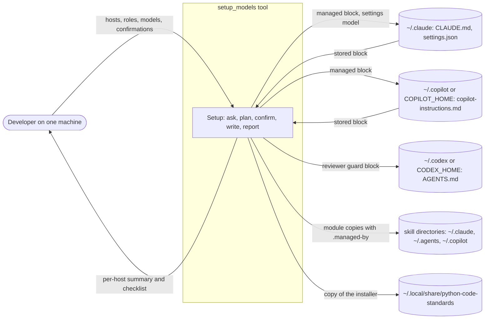
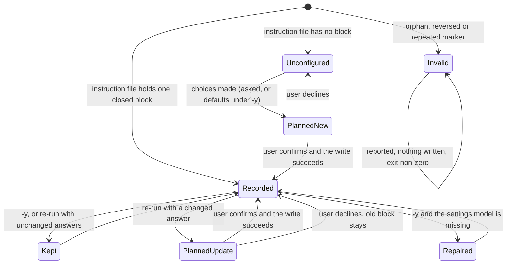
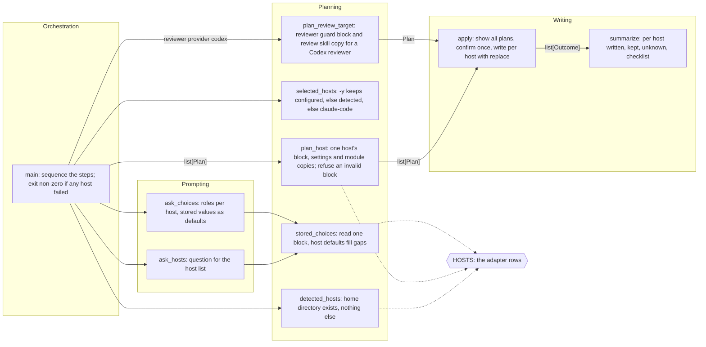

# Design: host-aware setup

Design mode, Standard size. Status: revision 4. Revision 3 added knowledge modules and role-scoped context (section 6A); its reviews (`reviews/review-r3-*.md`, Opus 5.5 and Codex) forced the honest guarantee levels, a separate `ReviewTarget` type, module copies folded into `Plan`, and the review-run command. Next: the work Copilot Enterprise seat. Inputs: `analysis.md`, the three requirements drafts in `requirements/`, and `verification-2026-11-17.md` (official-doc check of how each host loads instructions and skills). Extends `skill/tools/setup_models.py` (PR #120, merged to `main`).

## 1. Size and numbers

One process (the setup script's embedded Python tool), three layers (prompting, per-host planning, writing), two external homes (`~/.claude`, `~/.copilot` or `COPILOT_HOME`). Standard, because two external systems earn the context view.

- Values recorded: 2 hosts x (3 model roles + 1 reviewer provider) = 8 values.
- Files written per host: at most 2 for Claude Code (`CLAUDE.md`, `settings.json`); at most 1 for Copilot (`copilot-instructions.md`); plus the files of each skill installed for it (section 6A), and for Codex its `AGENTS.md` and the review skill. One more file is shared: the installer copy in `~/.local/share/python-code-standards`. "At most" because a file that would not change is not written.
- Nothing is written into the target repo by this step, on any host.
- Two coding hosts are in scope (`Host`), plus one review target (`ReviewTarget`, Codex; section 6A) that carries no models. The 8 values belong to the two coding hosts only. Homes touched: `~/.claude`, `~/.copilot` or `COPILOT_HOME`, `~/.codex` or `CODEX_HOME`, the skill directories of section 6A, and `~/.local/share/python-code-standards`.
- Knowledge today, in words: the always-loaded global `CLAUDE.md` is about 800; the python skill is `SKILL.md` 1,417 plus references 2,785 (about 4.2k words, loaded only when invoked). Per-environment duplication is therefore small; the reasons for modules are isolation and one source of truth, not token savings.

## 2. Context view



## 3. Domain states

A host, on this machine, is in exactly one of these states.



Types (frozen dataclasses): `Target` (name, home folder, its environment variable, summary note), with `Host` (the adapter row, section 6) and `ReviewTarget` (section 6A) built on it, and the installer copy a plain `Target`; `ModelChoices` (exists; the `reviewer_provider` field gains `copilot` and `none`), `Plan` (one target: its changes and notes, and for a host the choices it records; or an `Invalid` reason), `Change` (path, new text, shown text; exists), `Module` (a skill's name and files), `Outcome` (target, status, notes; feeds the summary).

## 4. Component flowchart



Every node owns one decision. `main` only sequences. Host-specific facts are data in `HOSTS`; behaviour that really differs is one row field, not a code path (ADR-1).

## 5. Boundary contracts

| boundary | input | output | grain/key | invariants | owner |
|---|---|---|---|---|---|
| `detected_hosts` | home, environ (both injected) | `tuple[Host, ...]` | one per host | looks only at whether the host's home directory exists; reads no file and no credential | `detected_hosts` |
| `selected_hosts` | `-y` flag, configured hosts, detected hosts, fallback | `tuple[Host, ...]` | one per host | pure; never prompts; `-y` order is configured, then detected, then `claude-code` | `selected_hosts` |
| user to `ask_hosts` | typed host list, or empty | `tuple[Host, ...]` | one per host name | unknown names re-asked; empty takes the `selected_hosts` default; at least one host | `ask_hosts` |
| `ask_choices` | host, stored `ModelChoices` or none | `ModelChoices` | one per host | provider in the host's allowed list; models free text; empty keeps the default; a changed provider takes the host default model | `ask_choices` |
| host file to `stored_choices` | file text, host | `ModelChoices` or none | one block per file | a missing line takes the host's default (never another host's); no block is none; an invalid marker pair is an `Invalid` result, never none | `stored_choices` |
| `plan_host` | host, home, environ, choices, overwrite flag | `Plan` | one per host | text outside the markers byte-identical, line endings of the file kept; an invalid block or unparsable settings file yields an `Invalid` plan that names the file; an existing settings `model` the tool did not write is preserved (the summary says so) | `plan_host` |
| `plan_review_target` | home, environ, host plans (the target is `CODEX`) | `Plan`, `Invalid` or none | one per review target | planned only when a selected host's reviewer provider is `codex`; block holds the reviewer guard only; an existing `AGENTS.override.md` makes the plan report that the block would be ignored; module copies only into missing or marked directories; unmarked skill directories or links are reported and never changed (no takeover) | `plan_review_target` |
| module install (`install`, called by `plan_host` and `plan_review_target`) | the module files the setup script staged (`--modules`), the host's choices, the skills directory | `Change`s and notes | one per module file | each module goes to the location of section 6A; no coding skill in any directory Codex scans when the provider is `codex`; overlaps for the selected set and the guarantee level are listed in the summary (`isolation`); the structural claim is checked, and reported broken when a coding skill exists in `~/.agents/skills` or the target repo's `.agents/skills` | `install` |
| installer copy | the running setup script (`--installer`) | `Plan` | one | copied to `~/.local/share/python-code-standards/setup-standards.sh` under the same confirmation, replace and link rules | `plan_installer` |
| `apply` | `list[Plan]`, `-y` flag | `list[Outcome]` | one per host | every path shown first; no write without a yes unless `-y`; each file is written to a temporary name then replaced; a failure on one host is reported and does not stop or alter the others | `apply` |
| `summarize` | `list[Outcome]` | text | one section per host | names what was written, kept, skipped as invalid, unsupported or unknown, plus the manual checklist (ADR-3) | `summarize` |
| repo | its root, injected into `main` (the setup script's current directory) | none | n/a | this step never writes inside the target repo; it only checks whether `.agents/skills/python-code-standards` exists there (`isolation`) | `main` |

## 6. Behaviour by host

The `Host` row holds: `name`, `home_dir` (`.claude`, `.copilot`), `home_env` (none, `COPILOT_HOME`), `instructions_name` (`CLAUDE.md`, `copilot-instructions.md`), `settings_model_key` (`model`, none), `heading` (the block's heading line), `defaults` (a `ModelChoices`), `providers` (allowed reviewer providers), `suggestions` (per provider), `gate_note` (text for the summary).

| | Claude Code | Copilot (CLI and VS Code agent mode) |
|---|---|---|
| Instruction file | `~/.claude/CLAUDE.md` | `$COPILOT_HOME/copilot-instructions.md` when set, else `~/.copilot/copilot-instructions.md` |
| Block heading | `## Models` (unchanged) | `## Models (Copilot)` |
| Model setting written | `settings.json` `model`, as today; an existing value the tool did not write is preserved | none (the key is unverified, ADR-5); the block records the choice and the summary says to pick the model in the picker or with `--model` |
| Defaults | coordinator `sonnet`, coding `opus`, reviewer `codex` / `gpt-5.4` (user decision 2026-11-17: Sonnet orchestrates, Opus codes, on every host; `opus` is the alias that tracks the latest available Opus, currently 5.5; the merged `DEFAULTS` in `setup_models.py`, today `opus` and `sonnet`, changed in Stage 1) | coordinator `Claude Sonnet 5.5`, coding `Claude Opus 5.5`, reviewer provider `copilot`, reviewer model `GPT-6 Astra` (picker names from the user's screenshot, 2026-11-17; the reviewer follows the repo's `.github/copilot-instructions.md`, which says `GPT-Astra` and no Codex review; two Astra models exist, `GPT-6 Astra` and `GPT-6.2 Astra`) |
| Reviewer providers | `codex`, `claude` (unchanged) | `copilot`, `none`; offering `codex` or `claude` at work waits for open question 3 |
| Model suggestions | `opus`, `sonnet`, `haiku` (claude); `gpt-5.4`, `gpt-5.4-mini` (codex) | the picker's names, from the user's screenshot of the model list (surface and seat not stated; assumed the enterprise seat): `Claude Opus 5.5`, `GPT-6 Astra`, `Claude Sonnet 5.5` (default), `MAI Code 2 Flash`, `MAI Code 2`, `GPT-6.1 Sol`, `GPT-6 Luna`, `Gemini 4 Carbon`, `GPT-6.1 Terra`, `Gemini 4 Hydrogen`, `GPT-6.2 Astra`, `GPT-6.2 Sol`, `Claude Sonnet 5`, `Claude Haiku 5.5`, `GPT-6 Sol`, `GPT-5.6 Sol`, `GPT-5.6 Luna`, `GPT-5.3-Codex`, `MAI-Code-1.1-Flash`, `Gemini 4 Argon`, `Gemini 3.8 Flash`, `Grok 4.7`, `Grok 4.6`; any other name is accepted, `picker` is accepted |
| Detection signal | `~/.claude` exists | `COPILOT_HOME` names an existing directory, or `~/.copilot` exists |
| Summary text | gate runs, as today | "Stop gate configured for Claude Code only. Copilot's mapping of the repo's `.claude/settings.json` hooks is unverified and Copilot already reads that file. To check by hand run the gates in `docs/quality-gates.md`." Also warns when `COPILOT_HOME` differs from `~/.copilot`, because VS Code may read the other path |

Facts behind this table (retrieved 2026-11-17 by Opus 5.5; none checked on an enterprise seat):

- Copilot CLI user instructions are `$HOME/.copilot/copilot-instructions.md`, moved by `COPILOT_HOME`. https://docs.github.com/en/copilot/how-tos/copilot-cli/add-custom-instructions
- VS Code's Copilot harness user file is `~/.copilot/copilot-instructions.md`; its Local harness also reads `~/.claude/CLAUDE.md` (setting `chat.useClaudeMdFile`). https://code.visualstudio.com/docs/agents/reference/custom-instructions-reference
- Copilot hooks (repo `.github/hooks`, user `~/.copilot/hooks`, repo `.claude/settings.json` also read); lower camelCase events with PascalCase accepted; preview. https://docs.github.com/en/copilot/reference/hooks-reference and https://code.visualstudio.com/docs/agent-customization/hooks
- `--model` and `COPILOT_MODEL` exist for the CLI (search snippet only). https://docs.github.com/en/enterprise-cloud@latest/copilot/reference/copilot-cli-reference/cli-programmatic-reference
- The documented CLI settings file location and any default-model key were not confirmed; sources disagree (`config.json` vs `settings.json`).
- `COPILOT_HOME` is documented for the CLI only. Its effect on VS Code is unknown.

## 6A. Knowledge modules and role-scoped context

Requirement (user, after revision 2): at home only the Claude and Codex configuration is used; at work only Copilot's; nothing is read twice; the knowledge is split into modular sections (common, Claude/Codex, Copilot Enterprise); and an adversarial reviewer must not read the coding guide, only review knowledge.

### What the docs let us promise

All three hosts load a skill's body only when the skill is chosen; only name and description sit in context (`verification-2026-11-17.md`). Which directories each host scans is a documented lower bound, not a proof of absence: VS Code's table "is not every directory it recognizes", and "not documented" is not "cannot".

| skill location | Claude Code | Codex | Copilot CLI | Copilot VS Code |
|---|---|---|---|---|
| `~/.claude/skills` | scans | not documented | not documented | scans (Claude harness) |
| `~/.agents/skills` | not documented | scans | scans | scans |
| `~/.copilot/skills` | no | no | scans | scans |
| repo `.claude/skills` | scans | not documented | scans | scans |
| repo `.agents/skills` | not documented | scans | scans | scans |

Always-on files, by default: Codex loads only `AGENTS.md` (`$CODEX_HOME`, then the repo; `AGENTS.override.md` replaces `AGENTS.md`; extra names only through `project_doc_fallback_filenames`). Claude Code loads `CLAUDE.md`, and reads repo `AGENTS.md` only when no `CLAUDE.md` exists or through an `@AGENTS.md` import. Copilot CLI loads `AGENTS.md`, `CLAUDE.md`, `.claude/CLAUDE.md` and its own files; VS Code's Copilot harness loads `copilot-instructions.md` and `AGENTS.md`, its Local harness also `CLAUDE.md`.

### The guarantee, stated honestly

Text and directories narrow what a model loads. They do not forbid it. Three levels:

| role and host | skills | repo files | injected `AGENTS.md` |
|---|---|---|---|
| Codex reviewer | structural: the coding skill is absent from every directory Codex scans | advisory (guard text) | outside our control |
| Claude reviewer | advisory: coding and review skills share `~/.claude/skills` | advisory | not applicable |
| Copilot reviewer (work) | advisory: both skills share `~/.copilot/skills` | advisory | outside our control |

The requirement is therefore met structurally only for the Codex reviewer, and as best effort for the others. The summary says which level applies.

### Modules and where they go

| module | content | form |
|---|---|---|
| common | typing, declarations, tests, verification, tooling: every file git tracks under `skill/` except the test-only package marker `skill/__init__.py` | skill `python-code-standards` |
| host | dropped: `SKILL.md` stays one file, Claude-only lines included | none |
| review | what counts as a defect; the repo's invariants as checkable claims; how to read the review brief; no coding how-to | skill `review-standards`, about 300 words (not named `adversarial-review`, which is the companion's command) |
| guard | one sentence in the host's always-on file | line inside the managed block |

Placement chooses the location the fewest unintended hosts scan, then lists the overlaps that remain:

| module | Claude Code machine | Copilot machine | unavoidable overlap |
|---|---|---|---|
| `python-code-standards` | `~/.claude/skills` | `~/.copilot/skills` (or `$COPILOT_HOME/skills`) | `~/.claude/skills` is also read by VS Code if both homes exist |
| `review-standards`, provider `codex` | `~/.agents/skills` | n/a | Copilot (both surfaces) also scans `~/.agents/skills` |
| `review-standards`, provider `claude` | `~/.claude/skills` | n/a | shares the coding skill's directory |
| `review-standards`, provider `copilot` | n/a | `~/.copilot/skills` | shares the coding skill's directory |

The plan is keyed on the set of selected hosts and the reviewer provider, because a machine can have several hosts (this machine has `~/.claude`, `~/.codex` and `~/.copilot`). Overlaps found for the selected set are listed in the summary.

### Codex as a review target, not a host

`ReviewTarget` is its own frozen dataclass, separate from `Host`: name `codex`, instruction file `$CODEX_HOME/AGENTS.md`, heading `## Review scope`, block text the reviewer guard. It has no models, no defaults, no settings key and no questions. It is planned whenever any selected host's reviewer provider is `codex`, and uses the same Unconfigured/Recorded/Invalid states, confirmation and write machinery as a host. Codex does not write code in this setup (`codex:rescue` is outside it); that is a decision, and a risk if it changes.

### Guard text

Two variants, because the roles differ.

- Coder guard, in each coding host's block: "Other agents' instruction files (<the list minus this host's own>) are not for you; do not open them unless a change touches them."
- Reviewer guard, in the Codex block and as the preamble of every review run: "You are a reviewer. Do not load the `python-code-standards` or `design-spec` skills and do not open `CLAUDE.md`, `.github/copilot-instructions.md` or `.claude/`. Use the `review-standards` skill." No exception clause, and no `skill/` path, so it holds in any repo.

An `AGENTS.md` in the target repo is injected before any text can act; the guard cannot retract it.

### Review run

The coordinator, not Codex, runs the brief, because Codex's sandbox is read-only and the brief writes a cache. The command, exactly:

`node "$CX" adversarial-review --background --scope branch --base main "<reviewer guard> <output of: uv run python -m tools.review_brief --base main>"`

The prompt names `review-standards` explicitly, because implicit skill matching under a fixed adversarial prompt is unreliable. `adversarial-review` also changes the stance to a design challenge with material findings only; the user's protocol uses plain `review`, which takes no focus text. Both points are open question 2. A risk is argument length and quoting of a multi-line brief on Windows, to be tested through that command.

### Existing installs and the user's own files

Setup marks each module directory it installs with a `.managed-by` file (content `python-code-standards setup`) and writes only missing or marked directories. Unmarked directories and symlinks are reported as not managed by setup and never changed; there is no takeover. A marked directory no longer wanted, after a provider change, is listed and not removed. On this machine that matters:

- `~/.agents/skills/python-code-standards` and `~/.agents/skills/design-spec` are unmarked symlinks into this repo. Codex scans that directory, so a Codex reviewer would see the coding skill today.
- `~/.claude/CLAUDE.md` and `~/.codex/AGENTS.md` (outside any block, user text) say "invoke the `python-code-standards` skill before reading or editing code". A reviewer reads code, so the line would load the guide. Setup reports it and does not edit it; wording it "when writing or editing" is open question 2.

Module copies are planned inside each host's `Plan` as `Change`s, with the same confirm-first, temporary-file-then-replace and per-host failure rules (ADR-4). There is no second configuration path.

## 7. Dependency matrix

One module (`setup_models.py`), standard library only; no import direction to enforce. It stays embedded byte-identically in `setup-standards.sh` and listed in `vendor_templates.SOURCES`.

## 8. Directory tree

```
skill/tools/setup_models.py        # + HOSTS rows, detected_hosts, selected_hosts, ask_hosts, plan_host, summarize; apply per host; Invalid block result
tests/test_setup_models.py         # + host cases with a fake home and an injected environ; updated to answer the host question
tests/test_setup_script.py         # + embedded-copy runs: Claude-only, Copilot-only, two hosts; every staged module file byte-identical to git-tracked skill/ and review-standards/SKILL.md
setup/setup-standards.sh           # re-embedded; stages the modules (MOD_ heredocs plus copies of templates it already embeds), passes --modules and --installer
review-standards/SKILL.md          # review-standards skill, about 250 words (provisional, ADR-9); written 2026-11-17, linked from ~/.agents/skills
codex/AGENTS.md                    # reviewer guard; ~/.codex/AGENTS.md links to it (written 2026-11-17)
tests/test_setup_models.py         # also NFR-11, NFR-12, NFR-14, NFR-15, markers, unmarked and linked directories, installer copy
tests/test_review_skill.py         # NFR-13; invariant drift as a pinned table: invariants 1-4 against docs/quality-gates.md, 5 against the root CLAUDE.md review protocol (no gate states it); the seeded-violation review check is a follow-up
skill/references/setup.md          # "Choose the models" gains the host question and the Copilot rows
docs/specs/host-aware-setup/       # this spec, the analysis, the drafts, the reviews
```

## 9. Decisions

### ADR-1: A small adapter table for the two decided hosts
- Status: Proposed
- Date: 2026-11-17
- Context: Claude Code and Copilot differ in instruction path, heading, settings key, defaults, providers and summary text; the gates and prompts are the same.
- Decision: one frozen `Host` row per host in `HOSTS`; functions take a `Host`. The row is only as large as the table in section 6. No claim that a further coding host is a one-row change. Codex is a separate `ReviewTarget` type (section 6A), not a row, because it has no models or defaults.
- Alternatives: a class per host (more structure than data that differs); `if host == ...` branches (every function edits for every host).
- Consequences: a new host starts as a row, plus whatever behaviour its contracts need.

### ADR-2: A host is configured when its instruction file holds one closed block
- Status: Proposed
- Date: 2026-11-17
- Context: the machine must remember its hosts without a new state file and without writing to the repo.
- Decision: no separate record. Configured hosts are the hosts whose file holds exactly one closed block; detection only supplies the question's default. A START without its END, an END before a START, or a repeated marker is `Invalid`: that host is skipped, its file is named in the summary, and the run exits non-zero. A deselected host's block is left alone and listed as "still configured; delete the block to remove it".
- Alternatives: a machine-local state file (a second source of truth); treating an orphan as no block (reproduced as data loss: the second run's merge spans the user's text and deletes it).
- Consequences: deleting a block unconfigures a host. The merged `setup_models.py` has the orphan-marker defect today (`block_span` and `merge_block`); this change fixes it, with a regression test, because ADR-2 depends on it.

### ADR-3: Report both Copilot surfaces; adapt as one; verify by hand
- Status: Proposed
- Date: 2026-11-17
- Context: Codex wants per-surface checks and an on-host smoke test; the verified docs show one harness and one instruction file, while enterprise policy can differ per surface. A smoke test needs the host installed, signed in and running.
- Decision: one `copilot` adapter. The summary prints one checklist with a row per surface (VS Code agent mode, Copilot CLI): open a session, ask which models it was told to use, confirm each hook fires. Setup then states "configured, not verified" for Copilot, never an equivalent-outcome claim.
- Alternatives: two adapters (duplicates one path); an opt-in automated verifier (kept out of scope, listed as a follow-up).
- Consequences: enforcement at work is confirmed by the user, once, with the checklist.

### ADR-4: Per-host plans, per-file atomic writes, no cross-host rollback
- Status: Proposed
- Date: 2026-11-17
- Context: one flat change list cannot isolate failures; today's `apply` raises on the first `PermissionError`.
- Decision: planning reads and parses every file first (an unreadable or unparsable file makes that host `Invalid`, naming the file). Writes go host by host, each file to a temporary name then replaced; a failed host is reported and the rest continue. The invariant is: a failure on one host does not stop or alter the others, and the run exits non-zero. It does not promise rollback of hosts already written.
- Alternatives: all-or-nothing rollback (more machinery than two small files justify).
- Consequences: a partial result is possible, visible in the summary, and repaired by re-running (the `-y` settings repair already does this).

### ADR-5: Do not write a Copilot default model until the key is verified
- Status: Proposed
- Date: 2026-11-17
- Context: sources disagree on the settings file and key; VS Code appears to offer only a picker.
- Decision: record the preference in the instruction block, default to `picker`, and say in the summary that selection happens in the picker or with `--model`.
- Alternatives: guess a key (a wrong key is silently ignored and looks configured).
- Consequences: honest but weaker at work until confirmed on the real seat.

### ADR-6: Knowledge modules are skills, placed where the fewest unintended hosts scan
- Status: Proposed
- Date: 2026-11-17
- Context: three hosts load instructions differently, and the user wants no cross-reading and a reviewer that never sees the coding guide. Skills are the one on-demand unit all three support. Each host's scan set is only a documented lower bound, and VS Code and Copilot CLI scan `~/.agents/skills` and, in VS Code, `~/.claude/skills`.
- Decision: ship common and review knowledge as skills (the `host.md` split was dropped; `SKILL.md` stays one file), placed per the table in section 6A, with the remaining overlaps listed in the summary. The claim is structural for the Codex reviewer only and advisory otherwise (guarantee table).
- Alternatives: one large always-loaded file per host (pays the tokens every session; Codex ignores `CLAUDE.md`); path-scoped instruction files (Copilot and Claude Code only); a separate reviewer home with no coding skill (the only way to make Claude and Copilot reviewers structural; heavier, deferred).
- Consequences: the guarantee is weaker than "isolation" and says so. NFR-11 checks every selected host's documented scan set, not only the directory written.

### ADR-7: Two short guards, and the brief is passed in the prompt by the coordinator
- Status: Proposed
- Date: 2026-11-17
- Context: text cannot stop auto-loading, but it can stop voluntary reads, which is what an exploring reviewer does. The review brief changes every run and Codex's sandbox is read-only, so Codex cannot make it.
- Decision: a coder guard in each coding host's block, and a reviewer guard (no exception clause, no repo-specific path) in the Codex block and as the preamble of each review prompt. The coordinator runs `review_brief` and appends its output to that prompt, naming `review-standards` explicitly (section 6A, Review run).
- Alternatives: no text (structure alone); one guard for both roles (the coder needs the change-touches exception, the reviewer must not have it); letting Codex run the brief (blocked by its sandbox).
- Consequences: the user's review protocol must call `adversarial-review` with the prompt, which also changes the review stance; that file is the user's (open question 2).

### ADR-8: The reviewer gets the definition of done, not the how-to
- Status: Proposed
- Date: 2026-11-17
- Context: independence matters, but a reviewer ignorant of the project's invariants re-flags what Ruff already covers and misses what the gates cannot see.
- Decision: the review skill carries a short list of the repo's invariants as checkable claims (for example 100% changed-line coverage, no unapproved suppressions) and reads `review_brief.py` output; it carries none of the coding guide.
- Alternatives: no project knowledge (noisy and shallow); the full coding skill (anchors the reviewer on the writer's guide).
- Consequences: the invariant list is a second place to keep current; a drift test compares it with the gate docs. A reviewer given invariants can anchor on them, so a review test seeds a violation outside the list and requires it to be found.

### ADR-9: Activation of the review skill is checked by an eval, and the skill is named explicitly
- Status: Proposed
- Date: 2026-11-17
- Context: implicit skill matching depends on the description and the prompt; Codex's review points out the machinery may not earn its keep.
- Decision: the review prompt names `review-standards` explicitly. An activation eval (a sample change, run through the review command) is a follow-up task; if it shows the skill adds nothing over the prompt alone, the skill is dropped and the prompt carries the checklist.
- Alternatives: rely on implicit matching (unreliable under a fixed adversarial prompt); skip the skill (loses the reusable form the user asked for).
- Consequences: the skill is provisional until the eval passes.

## 10. NFRs

| ID | Requirement | Target | Verified by |
|---|---|---|---|
| NFR-01 | No repo writes from this step | zero files under the target repo | test with a fake home and a repo directory, tree compared |
| NFR-02 | Text outside a block is preserved | byte-identical; the block is always written with LF (user decision 2026-11-17), even in a CRLF file | merge tests: CRLF, no final newline |
| NFR-03 | Malformed markers never lose text | orphan START, orphan END, two blocks: nothing written, file named, exit non-zero | one test per case, including the reproduced orphan case |
| NFR-04 | Existing Claude behaviour kept | every current behaviour holds; tests change only to answer the host question or to pass `environ` | existing assertions retained |
| NFR-05 | Idempotent | a second run with unchanged answers changes no byte | rerun test |
| NFR-06 | Home resolution | `COPILOT_HOME` wins over `~/.copilot`; Windows and WSL/Linux homes work; paths with spaces and non-ASCII characters work; the environment is injected, not read from the process | tests with a temporary home and a mapping |
| NFR-07 | Failure isolation | one failing host does not stop or alter the others; exit code non-zero | test with one unwritable path |
| NFR-08 | Interrupted write leaves old or new file | temporary file then replace | test that a failure before replace leaves the old bytes |
| NFR-09 | No personal data in written text; no network | block holds roles and model names only; the tool makes no network call | template-equality test; the tool imports no network module |
| NFR-10 | Changed code coverage | 100% statement and branch | `diff-cover` |
| NFR-11 | Placement and overlap | for every selected-host set and reviewer provider: the coding skill is absent from every directory Codex scans when the provider is `codex`; remaining overlaps equal the section 6A table; the summary lists them | install-plan tests, including {claude-code, copilot} with provider `codex` |
| NFR-12 | Always-on text stays small | managed block plus guard under 100 words per file; Codex chain well under its 32 KiB default | length assertion on the rendered block |
| NFR-13 | The reviewer carries no coding how-to | the review skill names no coding-guide file and its text shares no reference with it | test scanning the skill and its references |
| NFR-14 | Existing installs are not clobbered | only directories holding `.managed-by` are changed; unmarked directories and links are reported | test with an unmarked symlink and an unmarked directory |
| NFR-16 | Symlinked instruction files | a managed block is never written through a symlink that resolves outside the home directory; the plan reports the resolved path and writes only after a confirmed takeover | test with a symlinked `CLAUDE.md` into a fake repo; the repo file stays unchanged |
| NFR-15 | `AGENTS.override.md` is reported | a Codex target with that file present reports that its block is ignored | test with the file present |

## 11. Risks

- **Contract drift.** Copilot hooks are preview; paths and events may change. Mitigation: dated sources in section 6.
- **Existing hooks under Copilot.** Copilot already reads the repo's `.claude/settings.json`, so the Claude hooks may block or pass at work under a different contract. Not changed here; the Copilot summary says so (section 6).
- **Two homes on one machine.** VS Code's Local harness reads `~/.claude/CLAUDE.md`; a machine with both homes can load two model blocks that disagree. Mitigation: the Copilot block heading names the host.
- **Wrong path for VS Code.** `COPILOT_HOME` may not move VS Code's file; the summary warns.
- **Admin policy.** Organization policy may disable user instructions or hooks; Copilot is reported "configured, not verified".
- **Partial result.** ADR-4 allows one host written and another failed; the summary and exit code expose it.
- **Stale block.** A host dropped later keeps its old block (ADR-2); the summary lists it.
- **Same-host reviewer.** For reviewer providers `claude` and `copilot`, coder and reviewer skills share one directory; the guarantee is advisory (section 6A).
- **Skill routing is nondeterministic.** Activation depends on descriptions; the review prompt names the skill, and ADR-9 adds an activation eval.
- **`CODEX_HOME` mismatch.** Setup and the review process may resolve different homes; the summary reports the resolved path.
- **Stale modules after a provider change.** Marked directories no longer wanted are listed in the summary and never removed; the user deletes them.
- **Anchoring.** A reviewer given invariants may stop at them; ADR-8 adds a seeded-violation test.
- **Long review prompt on Windows.** A multi-line brief in an argument may hit quoting or length limits; tested through the exact command.
- **Writing through symlinks.** On this machine `~/.claude/CLAUDE.md` and `~/.codex/AGENTS.md` are symlinks into this repo, so the merged `setup_models.py` would write a models block into a tracked repo file; NFR-16 stops that.
- **User text that loads the guide.** `~/.claude/CLAUDE.md` and `~/.codex/AGENTS.md` tell every session to invoke the coding skill before reading code; reported, not edited.
- **Reviewer still explores.** Codex reads whatever files it chooses; the guard and directories narrow it, they do not forbid it.
- **Invariant list drift.** The review skill's invariants can fall behind `docs/quality-gates.md`; ADR-8 adds a drift test.
- **Skill directories overlap on Copilot.** VS Code also reads `.claude/skills` and `~/.claude/skills`, so a machine with both homes shows the coding skill to Copilot too.

## 12. Review notes for the work Copilot Enterprise seat

Please confirm or correct, from the real seat:

1. The user instruction path in VS Code agent mode and in Copilot CLI, and whether `COPILOT_HOME` moves both.
2. Whether a settings file can hold a default model in either surface, and its key.
3. Whether organization policy allows user instruction files and user hooks.
4. Whether `Stop` in `.claude/settings.json` maps to `agentStop`, and its payload and failure behaviour.
5. The model names the picker shows, to fill the suggestion list.

## 13. Open questions

1. **Delivery. Resolved (Stage 3):** one self-contained installer outside the skill, `setup/setup-standards.sh`, embeds every module file and copies them (one path, works with no clone and no access to this repo); it keeps a copy of itself in `~/.local/share/python-code-standards/`, where a copied skill finds it. Symlinks to a clone are managed by hand on the home machine and setup leaves them alone (NFR-14). A link-from-clone mode remains possible later if the work machine may clone this repo.
2. **Resolved on 2026-11-17 by the user's instruction, except (a).** Done: (b) the rule is now "when writing or editing" in the global `CLAUDE.md`, with a coder guard line; (c) the coding and `design-spec` links are removed from `~/.agents/skills`, `review-standards` is linked there, and `~/.codex/AGENTS.md` is a symlink to `codex/AGENTS.md` (old file saved as `~/.codex/backups/AGENTS.md.2026-11-17`). Still open: (a) switching the review protocol from plain `review` to `adversarial-review` with the guard and brief, which also changes the review stance.
3. **Resolved 2026-11-17 by the user:** the reviewer at work is `GPT-6 Astra`. The repo's `.github/copilot-instructions.md` still says `GPT-Astra`, which matches no picker name exactly; it is reported here and not changed. The spec treats the screenshot as the enterprise seat's list.

Carried from revision 2, still unanswered: should the repo's existing `.claude/settings.json` hooks stay as they are, knowing Copilot already reads that file? The spec leaves them unchanged and reports it in the Copilot summary.

Approve or correct before I implement.
